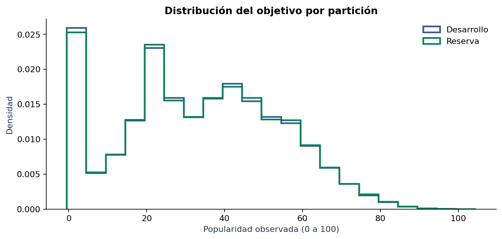
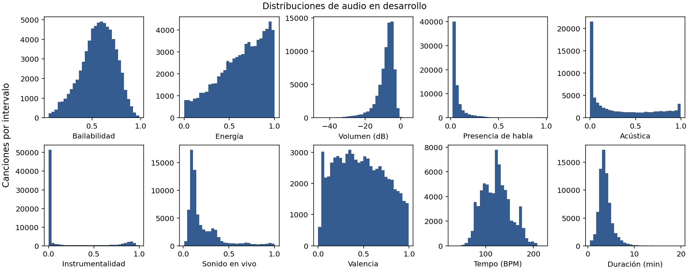
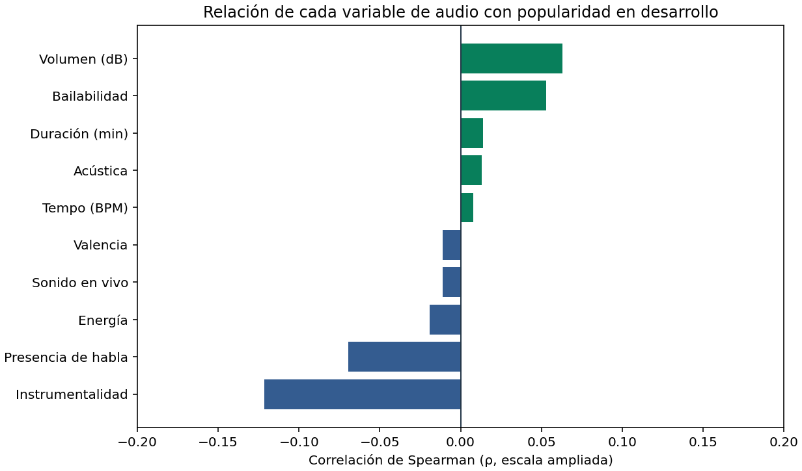
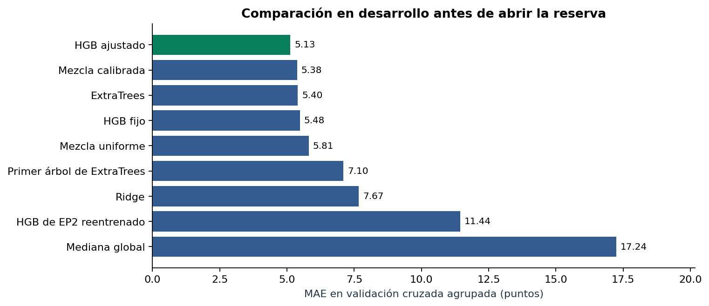
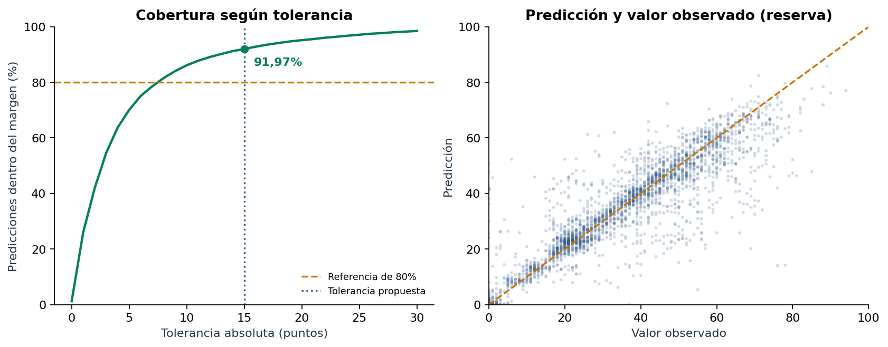
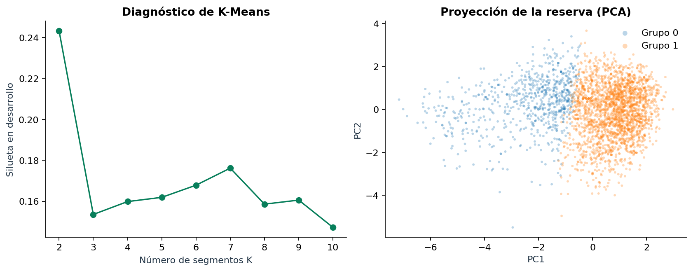

# Informe técnico · Spotify Tracks · Evaluación Parcial 3

**MLY1101 Machine Learning · Caso C · Benjamín Palomino y Benjamín Díaz.**

Para reproducir la solución: [guía de ejecución](README.md), [notebook](../../notebooks/06_evaluacion_3.ipynb), [evidencias](../../reports/eva3/) y [resumen para decisión](informe_ejecutivo.md). El [protocolo](protocolo.md) distingue métricas técnicas y metas comerciales.

## 1. Problema de negocio y objetivos

La audiencia es un equipo de curaduría que necesita priorizar qué canciones revisar en un catálogo amplio. La solución entrega una **estimación de popularidad observada de 0 a 100** y perfiles acústicos para navegar por el catálogo. La puntuación sirve para sugerir un orden de revisión: la decisión de inclusión o promoción sigue a cargo de la persona. El escenario es académico y no acredita una intervención comercial.

El objetivo principal es comparar regresores, optimizar su configuración y medir el aporte de los ensambles en condiciones comparables. Los objetivos secundarios son documentar cómo progresa cada dato desde el CSV hasta la predicción, estimar el error fuera del entrenamiento y distinguir perfiles que puedan orientar la revisión de catálogo. La fuente no incluye fechas, reproducciones ni historial de exposición. No se puede pronosticar popularidad futura o atribuir causalidad a una característica acústica.

## 2. Indicadores

| Indicador | Medición | Decisión asociada |
|---|---|---|
| MAE, primario | Error absoluto promedio en puntos de popularidad. | Elegir menor MAE en CV agrupada y contrastar en test reservado. |
| RMSE y R² | Penalización de errores grandes y comparación cuadrática con la media observada. | Revisar si la media del error oculta fallos graves. R² no es accuracy. |
| Mejora de MAE | Comparación con mediana global y referencia HGB de EP2 reentrenada sobre las mismas filas. | Separar el valor sobre una regla simple del avance frente a EP2. |
| Cobertura ±5/10/15/20 | Fracción de predicciones con error absoluto no superior a cada tolerancia. | Lectura operativa; referencia propuesta para ±15: estrictamente >80%. |
| Integridad de partición | IDs y grupos compartidos entre entrenamiento y prueba, y dentro de cada fold. | Una intersección distinta de cero invalida el contraste. |
| Tiempo de revisión | Cambio mediano de minutos por 100 canciones en piloto pareado. | Meta propuesta: reducción ≥15%. |
| Aceptación y cobertura de géneros | Recomendaciones aceptadas sobre revisadas; cambio de cobertura de géneros en puntos porcentuales. | Metas propuestas: aceptación ≥70% y caída de cobertura ≤5 pp. |

El 80% de **Buen desempeño** en la pauta es un nivel de calificación. Como la indicación verbal no identifica una métrica, se interpreta **provisionalmente** como cobertura a ±15 puntos y se informa R² por separado. La cobertura usa todas las predicciones evaluadas, no una submuestra favorable. Las metas comerciales se reservan para el piloto; esta entrega no presenta ahorro observado ni ROI.

## 3. Fuente, calidad y trazabilidad de los datos

La fuente inmediata es el CSV de `Spotify_Dataset.zip` entregado para el Caso C. Se conserva el CSV bruto del repositorio y se compara el contenido normalizando únicamente finales de línea para resolver la diferencia CRLF/LF. El archivo no incorpora una fecha de captura verificable ni describe cómo se seleccionó su catálogo. La EP2 declaró el catálogo [Spotify Tracks Dataset de MaharshiPandya](https://www.kaggle.com/datasets/maharshipandya/-spotify-tracks-dataset) como origen público; no se afirma una verificación independiente de la licencia o la población de esta copia.

| Huella SHA-256 | Valor |
|---|---|
| ZIP recibido | `40cd5ca85461ed70d00810bfbbe2395e37109d533ea683c03a064927bdce82e6` |
| CSV local preservado con CRLF | `335e5ee0a07a3f30b20ca9860c87562c98082a032e0ecd90e8ca0a86d965fe58` |
| Miembro CSV del ZIP y CSV local normalizado a LF | `b202fa49909b2d5cef71a04b1d21243cfeb36414535f2ca9272aa646721177bd` |
| Manifiesto de partición EP3 | `db12b3d3172ce9acd9c175b4093d9f6e14f2ec76849f4c71d9042a3e8b796130` |

| Bloque | Variables o registros | Uso previsto |
|---|---|---|
| Variable objetivo | `popularity` numérica. | Solo etiqueta, control de calidad y estratificación; se excluye de predictores. |
| Audio continuo | Duración, baile, energía, sonoridad, voz, acústica, instrumentalidad, ambiente en vivo, valencia y tempo. | Predicción y perfiles; se conservan unidades en interpretación. |
| Contexto musical | Género, tonalidad, modo, compás y contenido explícito. | Predicción y auditoría; tonalidad, modo y compás son categorías. |
| Identificación | ID, artistas, álbum y título. | Trazabilidad, agrupación y auditoría; cualquier representación de contexto se declara por modelo. |
| Índice exportado | `Unnamed: 0`. | Se elimina. Su orden por género no debe funcionar como predictor. |

El recorrido es `CSV bruto → controles de esquema y rangos → una fila por track_id → grupos → split → transformaciones por fold → predicciones → métricas`. Los conteos por etapa quedan en [`cleaning.csv`](../../reports/eva3/cleaning.csv), los tipos y faltantes en [`schema.csv`](../../reports/eva3/schema.csv), el destino de cada fila bruta en [`row_lineage.csv.gz`](../../reports/eva3/row_lineage.csv.gz) y la asignación de cada registro retenido en [`split_manifest.csv`](../../reports/eva3/split_manifest.csv). El CSV comprimido de trazabilidad se abre directamente con `pandas.read_csv` e incluye índice de fila de origen (desde cero), decisión, etapa, partición y componente cuando se conserva. Los errores de calidad no se corrigen eligiendo la fila que mejore la métrica. Cuando un ID tiene varias puntuaciones, se conserva la observación definida por la regla heredada y se registra el desacuerdo. Sin fecha no se sabe cuál observación es cronológicamente más apropiada.

| Etapa medida | Filas retenidas | Filas descartadas en la etapa |
|---|---:|---:|
| CSV bruto: 21 columnas, 89.741 IDs, tres celdas nulas | 114.000 | — |
| Retiro del índice exportado | 114.000 | 0 |
| Metadatos obligatorios presentes | 113.999 | 1 |
| Primera fila por `track_id` | 89.740 | 24.259 |
| Duración entre 30 segundos y 20 minutos | 89.653 | 87 |
| Tempo y compás admisibles | 89.495 | 158 |
| Rangos de audio; 20 columnas, 113 géneros, cero nulos | 89.495 | 0 |

Retención: **78,50% de las filas brutas** y **99,73% de los IDs únicos**. La diferencia proviene principalmente de duplicados; ambos denominadores se mantienen. Los límites de duración son decisiones de alcance, no una definición universal de música válida. Se encontraron **720 IDs con puntuaciones incompatibles** (570 en entrenamiento, 150 en test); el rango mediano es 1 punto y el máximo, 44. La regla sigue la primera observación válida de EP2 y no el máximo, la última aparición ni la que minimice el error.

### Exploración y limitaciones del origen

Las distribuciones por banda del objetivo y género permiten detectar desequilibrios sin recortar popularidades extremas. El promedio de popularidad es **33,17** en entrenamiento y **33,33** en test. En test, **61,18%** de canciones está entre 0 y 40, y solo **109** (0,61%) entre 81 y 100. El promedio global pondera principalmente los rangos bajos y medios, por lo que el error de extremos se examina aparte. Revisar las figuras de [EP3](../../images/eva3/) junto con [`descriptive.csv`](../../reports/eva3/descriptive.csv), [`target_bands.csv`](../../reports/eva3/target_bands.csv) y [`genre_counts.csv`](../../reports/eva3/genre_counts.csv). Las asociaciones descriptivas no demuestran el efecto causal del audio ni la representatividad del archivo para todo Spotify. La limpieza conserva un solo género por ID según el orden observado en el CSV, que no es una anotación validada por curadores.

En las **71.582 canciones de desarrollo**, el 33,51% tiene instrumentalidad igual a cero y la duración mediana es 3,56 minutos. Los histogramas muestran la concentración en cero y la dispersión por variable en sus unidades originales, con duración expresada en minutos. La mayor asociación individual con popularidad en valor absoluto corresponde a instrumentalidad (Spearman **−0,122**). Estas asociaciones son débiles y se usan para describir el catálogo. Se conserva la comparación de modelos del protocolo para evaluar predicciones con varias variables e interacciones. Los coeficientes están en [la tabla de EDA](../../reports/eva3/eda_audio_correlations.csv).

## 4. CRISP-DM y avance entre entregas

| Fase | Aplicación en esta entrega | Evidencia |
|---|---|---|
| Comprensión del negocio | Delimitar priorización de revisión, objetivos, usuario y condiciones del piloto. | Secciones 1 y 2; informe ejecutivo. |
| Comprensión de datos | Verificar procedencia, distribución, faltantes, duplicados y desacuerdos de etiqueta. | `data_audit.json`, EDA, `target_conflicts.csv`. |
| Preparación | Preservar reglas comparables de limpieza y endurecer agrupación y separación. | `cleaning.csv`, `split_manifest.csv` y pruebas. |
| Modelamiento | Comparar referencias, modelos supervisados, ensambles y perfiles sin etiqueta. | Configuraciones, `search_trials.csv`, perfiles. |
| Evaluación | Separar selección y test; analizar error, cobertura y variación por subgrupo. | `cv_folds.csv`, `supervised_metrics.csv`, `evaluation.json`. |
| Despliegue | Persistir la solución y proponer verificación local y piloto supervisado. | Modelo, CLI, reglas de aceptación del piloto. |

La EP2 empleó huellas exactas de atributos; la EP3 añade una clave normalizada de artista principal y título. Las coincidencias se unen de forma transitiva: si A coincide por huella con B y B por clave con C, los tres permanecen juntos. Esto reduce riesgo de separar variantes reconocibles, aun cuando no coincidan los atributos exactos. Títulos iguales de un artista pueden ser piezas distintas y remasterizaciones con títulos diferentes pueden escapar del control. No se presenta el grupo como una huella de forma de onda ni se afirma separación completa de artistas.

Hay **83.282 huellas exactas**; al unir ambos tipos de enlace quedan **80.401 componentes**, 2.579 de ellos con más de una huella exacta. La clave de texto no enlaza los 33 registros con títulos o artistas genéricos. La semilla 3103 separa componentes completos aproximadamente 80/20, estratificando por deciles de la mediana del objetivo del componente. El objetivo no forma parte de la clave. Quedan **71.582 canciones y 64.320 grupos de entrenamiento**, frente a **17.913 canciones y 16.081 grupos de test**. No se cruzan IDs, componentes, huellas exactas ni claves de grabación utilizables. El **89,58%** de las filas de test tiene artista principal presente en entrenamiento, por lo que el alcance es componentes no vistos de la misma fuente, no artistas totalmente nuevos.

El cambio de agrupación modifica la composición de test. En EP2 se cruzaban **876 claves de texto** bajo la regla nueva. En EP3, **3.544** de las 17.913 filas de test ya eran test de EP2 y **14.369** eran entrenamiento de EP2. Los valores históricos aportan contexto, no una comparación pareada. Para atribuir una mejora a la configuración de EP3 se compara la referencia de EP2 reentrenada en el protocolo de EP3. El contraste se documenta en [`ep2_overlap.csv`](../../reports/eva3/ep2_overlap.csv); la EP3 no cuenta con una fuente externa independiente.

## 5. Modelos, optimización y ensambles

La predicción es regresión. La mediana global es una referencia barata para MAE; el HGB de EP2, con audio y género y sin historial de artistas o álbumes, se reentrena para obtener una referencia más exigente. La regresión lineal regularizada y el árbol individual aportan contrastes supervisados de distinta complejidad.

| Familia | Variantes y propósito |
|---|---|
| Referencias | Mediana global (`dummy_mediana`) y configuración histórica reentrenada (`hgb_ep2`). |
| HistGradientBoosting | `hgb_metadatos_base` y `hgb_metadatos_ajustado`; árboles sucesivos para modelar interacciones y errores del conjunto anterior. |
| Árbol y ExtraTrees | `arbol_metadatos` es el primer árbol del ExtraTrees ajustado; `extra_trees_metadatos` promedia 100 árboles aleatorizados con remuestreo. |
| Ridge | `ridge_metadatos`; base lineal con categorías one-hot dispersas, agrupación de las menos frecuentes y penalización L2. |
| Mezclas | `mezcla_uniforme` promedia HGB, ExtraTrees y Ridge ajustados; `mezcla_calibrada` busca pesos no negativos que suman 1 para tres configuraciones fijas. |

**Historial de catálogo.** Para árboles con metadatos, se calculan media, mediana, proporción de ceros y `log(1+n)` de popularidad por género, artista principal, crédito completo, álbum y combinaciones artista–álbum/artista–género. Las estadísticas se suavizan hacia referencias globales del subconjunto de ajuste y una categoría no vista recibe la referencia global y conteo cero. En el ajuste de cada fold, el historial se calcula con cuatro particiones internas: una fila no aporta su etiqueta a su propio predictor ni al de su grupo. La transformación de validación y test usa solo tablas del entrenamiento respectivo. Ridge codifica categorías de artista y álbum sin usar la etiqueta para crear la codificación. `track_id`, `track_name`, huellas e índice exportado no son entradas del predictor. Este historial presupone disponer de canciones etiquetadas de catálogo similar para inferencia; no mide popularidad futura ni elimina la dependencia de artistas y álbumes conocidos.

El contraste de optimización conserva los predictores y la validación, y compara la variante de boosting fija contra la ajustada. Se prueban ocho configuraciones de HGB (pérdida cuadrática/absoluta, tasa, iteraciones, hojas y regularización), tres de ExtraTrees (tamaño mínimo de hoja y fracciones de atributos y filas) y tres de Ridge (fuerza L2), con cinco folds para cada alternativa. La pérdida absoluta se alinea con el MAE y la cuadrática es un contraste sensible a valores grandes. Se combinan tasas menores con más iteraciones para explorar capacidad sin ampliar indiscriminadamente los árboles; regularizar y subir el tamaño mínimo de hoja limita patrones sustentados por pocos ejemplos. Se guardan configuraciones y resultados por fold en [`search_trials.csv`](../../reports/eva3/search_trials.csv) y el resumen en [`search_summary.csv`](../../reports/eva3/search_summary.csv). La ganancia respecto al fijo se reporta incluso si el orden se invierte en test.

Para aislar el promedio del ensamble se compara ExtraTrees con **su primer árbol**, misma realización de ajuste. Esto controla arquitectura, entradas y configuración; una sola realización del árbol no estima la variabilidad de todos los árboles aislados. La mezcla uniforme no ajusta pesos. La calibrada explora el simplex en pasos de 0,1 y minimiza MAE; dentro de cada fold elige pesos en un subconjunto agrupado de entrenamiento del fold, sin usar su validación. Al finalizar, aprende los pesos con predicciones OOF de las configuraciones fijas sobre todo el entrenamiento. La mezcla calibrada y la uniforme emplean componentes de distinta configuración, por lo que su diferencia no aísla únicamente el efecto de los pesos. Un ensamble con peor resultado que su mejor componente no se declara superior por complejidad.

## 6. Evaluación y selección

El modelo y sus transformadores se ajustan dentro de cada uno de cinco folds de entrenamiento. Los grupos que van a validación no pueden estar en entrenamiento del mismo fold. Se ordenan candidatos por el MAE medio de CV, se registra la decisión en [`selection.json`](../../reports/eva3/selection.json) y después se calculan predicciones del test reservado. Los valores originales de `popularity` permanecen observados y todas las predicciones se acotan a [0, 100]. El test sirve para auditoría final y no para elegir otro ganador. La grilla y la selección global reutilizan los mismos folds; sus cifras sirven para comparar y pueden ser optimistas. No se presentan como CV completamente anidada. La reserva no se usa para ajustar ni seleccionar, pero procede del mismo origen estudiado en EP2.

La tabla comparativa y sus predicciones están en [`supervised_metrics.csv`](../../reports/eva3/supervised_metrics.csv), [`cv_folds.csv`](../../reports/eva3/cv_folds.csv) y [`test_predictions.csv`](../../reports/eva3/test_predictions.csv). En los [contrastes controlados](../../reports/eva3/controlled_contrasts.csv), el delta es `MAE_referencia - MAE_candidato`; positivo implica menor error del candidato. El remuestreo pareado conserva la comparación de ambos modelos sobre los mismos grupos. Los intervalos de bootstrap describen incertidumbre de la muestra de test, condicionada a los modelos entrenados. No son un intervalo por canción ni incluyen la variabilidad de entrenar con otro catálogo. Se contrastan las bandas de popularidad y las categorías con tamaños de muestra suficientes; las categorías pequeñas se informan con su tamaño y no orientan decisiones operativas.

| Modelo | MAE CV | MAE reserva | RMSE reserva | R² reserva | ±15 en reserva |
|---|---:|---:|---:|---:|---:|
| HGB ajustado | **5,129** | **5,020** | 8,501 | 0,830 | 91,97% |
| Mezcla calibrada | 5,377 | 5,219 | **8,210** | **0,841** | 92,65% |
| ExtraTrees ajustado | 5,400 | 5,251 | 8,268 | 0,839 | 92,41% |
| HGB fijo | 5,483 | 5,278 | 8,285 | 0,838 | 92,65% |
| Mezcla uniforme | 5,814 | 5,575 | 8,478 | 0,831 | 92,19% |
| Primer árbol de ExtraTrees | 7,100 | 6,942 | 10,826 | 0,724 | 86,33% |
| Ridge ajustado | 7,671 | 7,178 | 10,450 | 0,743 | 86,58% |
| HGB de EP2 reentrenado | 11,442 | 11,381 | 16,368 | 0,369 | 73,13% |
| Mediana global | 17,244 | 17,266 | 20,607 | −0,0003 | 52,68% |

**IE9 — optimización.** Con los mismos predictores, HGB pasa de MAE 5,483 a 5,129 en CV (mejora en 5/5 folds). Gana la prueba 6: pérdida absoluta, tasa 0,07, 340 iteraciones, máximo 63 hojas, mínimo 14 observaciones por hoja y regularización L2 de 2. En reserva mejora **0,257 puntos** frente al fijo (IC95% pareado **[0,221; 0,293]**), aunque el RMSE aumenta. Frente a EP2 reentrenado, la reducción de MAE de **55,89%** reúne cambios en variables y ajustes, por lo que no se atribuye solo a los hiperparámetros.

**IE10 — ensambles.** ExtraTrees reduce el MAE de su primer árbol de 6,942 a 5,251 en reserva (**24,35%**; IC95% de la reducción **[1,602; 1,779]** puntos). La mezcla uniforme empeora **0,554 puntos** frente a su mejor componente. La calibrada mejora RMSE y R² frente al ganador, pero tiene mayor MAE de desarrollo. Se conserva el ganador fijado por CV.

**IE11 — generalización.** El MAE de CV es **5,129 ± 0,043** (desviación de los cinco folds). En reserva, IC95% por grupos para el MAE **[4,916; 5,136]**. Cobertura a ±5/10/15/20: **70,10% / 86,13% / 91,97% / 95,17%**. A ±15 el IC95% es **[91,58%; 92,39%]**. El R² global también supera 0,80; ninguna de estas métricas es accuracy. En **1.867** registros de artistas no vistos, MAE **7,85**, R² **0,608** y ±15 **81,68%**; para artistas vistos el MAE es **4,69**. En popularidad 81–100 (109 registros), MAE **14,45** y ±15 **55,05%**. El promedio no representa todos los subgrupos.

**IE12 — KPI de decisión.** En 3.582 revisiones (20% de la reserva), se define popularidad alta como ≥49, percentil 75 de entrenamiento. El ganador identifica 3.065 canciones altas (**85,57%** de su lista y **67,78%** de las altas presentes), frente a 62,00% de la referencia EP2 y 25,24% esperado con selección uniforme. La media de la lista es **58,92** y aparecen **82/113 géneros**. La mezcla uniforme obtiene 85,68% de precisión de lista, pero el ranking comercial no decidió el ganador ni representa un piloto. Véase [comparación a igual presupuesto](../../reports/eva3/business_candidates.csv).

**Robustez del umbral.** En 600 remuestreos de familias, el IC95% del R² global es **[0,820; 0,839]**. En artistas no vistos, es **[0,561; 0,652]**; incluso su cobertura a ±15 (81,68% puntual) tiene un IC95% de **[79,72%; 83,41%]**, que incluye 80%. Estos intervalos son condicionales al modelo ya ajustado y a la reserva del mismo origen. Para el piloto, mostrar si existe historial y enviar canciones de artistas sin historial a revisión manual sin penalizarlas por la predicción. No se ha medido el efecto de esa regla operativa. Ver [auditoría por artista](../../reports/eva3/bootstrap_artist_seen.json).

## 7. Segmentación no supervisada

Los perfiles se calculan a partir de audio continuo, sin `popularity` en el ajuste. Las transformaciones se aprenden en entrenamiento. K-Means permite sintetizar perfiles acústicos; la silueta y el tamaño de segmentos informan la elección de K. PCA se utiliza como apoyo visual: los ejes conservan una parte de la variación, y una proyección solapada o clara no valida por sí sola los grupos. Si se incluyen puntuaciones de popularidad por segmento, se calculan después de ajustar y sirven para describir, no para definir el clúster.

La regla elige **K=2**: mayor silueta en una muestra fija del entrenamiento, con tamaño mínimo de 3% por grupo. El codo geométrico sugiere **K=4**, evidencia de que no hay un único K óptimo. La silueta de muestra pasa de **0,243** en entrenamiento a **0,242** en test; la separación es modesta. Dos semillas alternativas dan ARI **0,999** y **0,998** respecto de la referencia; esto indica estabilidad de asignaciones en el entrenamiento, no fronteras nítidas. Dos componentes PCA explican **44,41%** de la varianza y seis alcanzan 80%. Se usa PCA para ilustrar, no para certificar la geometría.

| Perfil | % en entrenamiento | % en test | Energía media en entrenamiento | Acústica media | Tempo (BPM) | Uso propuesto |
|---|---:|---:|---:|---:|---:|---|
| 0 | 24,98 | 25,36 | 0,30 | 0,75 | 110,3 | Explorar listas de escucha tranquila. |
| 1 | 75,02 | 74,64 | 0,75 | 0,18 | 126,3 | Priorizar revisión para listas activas. |

Son perfiles de canciones, no segmentos de usuarios. La mayor diferencia de participación es **0,38 pp**; el ajuste se mantiene sobre los mismos centroides en test. Las sugerencias deben validarse con curadores y no equivalen a categorías definitivas.

## 8. Ética, límites y recomendaciones

- **Exposición previa.** La popularidad refleja visibilidad, promoción y disponibilidad además del sonido. Utilizar la salida como regla única podría reforzar la exposición de catálogos ya conocidos.
- **Errores desiguales.** Revisar MAE, sesgo y cobertura por banda de popularidad y categorías relevantes. Un buen promedio no justifica detectar automáticamente canciones muy populares ni descartar otras.
- **Representatividad.** Sin fecha de captura, país, método de muestreo ni datos de usuarios no se generaliza a un período futuro o a toda la plataforma. La clave de agrupación tampoco resuelve una auditoría de catálogo por artista nuevo.
- **Uso de metadatos.** Los identificadores de la fuente sirven para reproducibilidad. Limitar su difusión a la necesaria, confirmar derechos antes de redistribución fuera del curso y evaluar muestras recientes antes de producción.
- **Próxima decisión.** Considerar solo una prueba piloto con revisión humana. Registrar tiempo, aceptación, diversidad de géneros y casos en que la herramienta orienta mal. No ejecutar promoción automática ni afirmar retorno comercial.

## 9. Matriz de la pauta

| Indicador | Peso | Evidencia verificable |
|---|---:|---|
| IE9 · Optimización de hiperparámetros | 20% | Diseño de grilla justificado, resultados de cada configuración y contraste fijo vs. ajustado sobre los mismos folds. |
| IE10 · Ensambles | 30% | Contraste controlado de árboles individuales vs. ensamble y comparación de combinación con sus componentes. |
| IE11 · Generalización | 20% | Manifiesto de grupos, folds auditables, MAE/RMSE/R², tolerancias, prueba reservada e incertidumbre. |
| IE12 · Selección y justificación | 30% | Criterio previo, decisión registrada, comparación contra reglas simples y condiciones de uso de negocio. |

La pauta requiere además al menos dos modelos supervisados y una técnica no supervisada, informe Markdown, notebook reproducible, dataset y estructura profesional. La exposición grupal de diez minutos y la defensa individual quedan fuera de esta entrega técnica; ambos integrantes deberán dominar el flujo completo.
