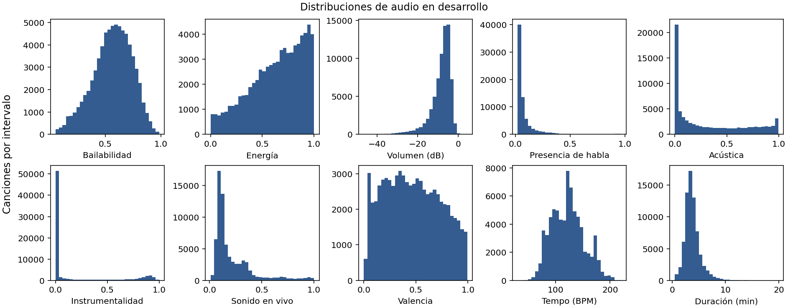
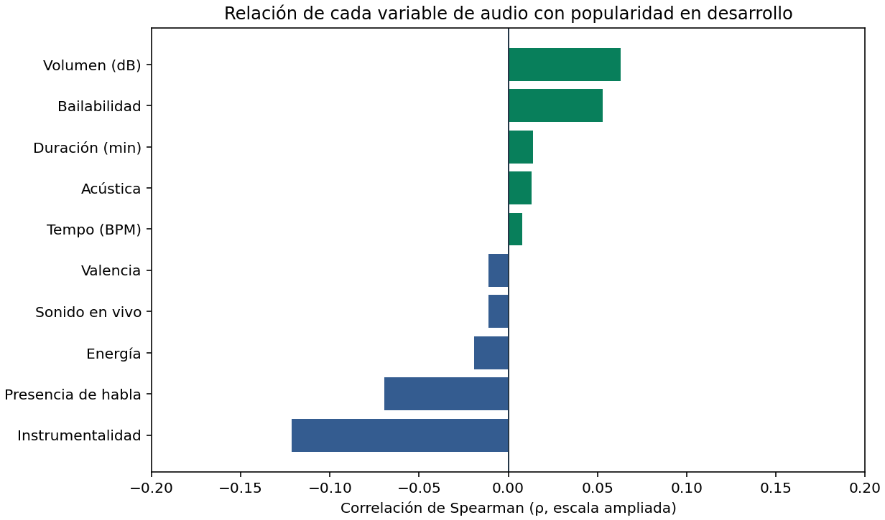
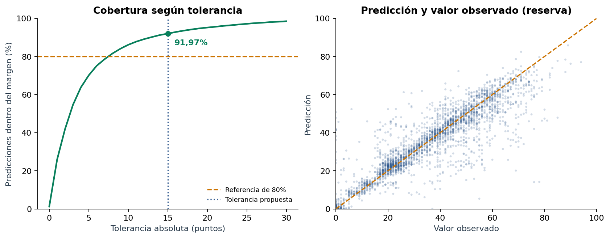
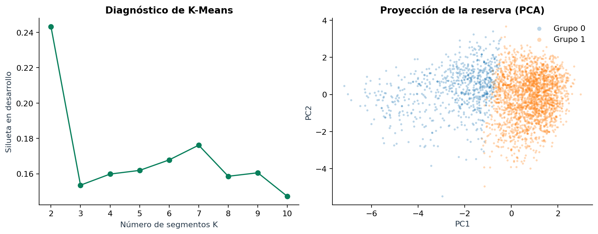

# Informe técnico · Spotify Tracks

**Evaluación Final Transversal · MLY1101 · Caso C**

**Benjamín Palomino y Benjamín Díaz**

[Resumen ejecutivo](informe_ejecutivo.md) · [Notebook ejecutable](../../notebooks/07_examen_transversal.ipynb) · [Presentación](Spotify_ET.pptx) · [Guía de ejecución](README.md)

## 1. Problema de negocio y objetivos

Un equipo de curaduría tiene tiempo limitado para revisar canciones. El proyecto estima la popularidad observada en la escala 0–100 para ordenar esa revisión. También agrupa canciones por atributos de audio para explorar listas con perfiles distintos. La decisión final de inclusión corresponde a curaduría.

El objetivo principal es reducir el error en puntos de popularidad frente a una regla simple y a la referencia de EP2, usando los mismos registros de evaluación. Los objetivos secundarios son explicar cuánto aporta el ajuste y el ensamble bajo condiciones comparables, medir diferencias de error entre subgrupos y estimar cuánto mejora la priorización con un cupo fijo de revisión. El alcance es una comparación retrospectiva dentro de un catálogo sin fecha de captura verificable.

## 2. Indicadores y criterios de decisión

| Indicador | Cálculo y uso | Resultado o meta |
|---|---|---|
| MAE | Promedio del error absoluto en puntos. Criterio de selección en cinco folds agrupados. | **5,129** en validación y **5,020** en reserva para el HGB ajustado. |
| RMSE y R² | RMSE da más peso a los errores grandes. R² compara el error cuadrático con predecir la media de la reserva. | **8,501 puntos** y **0,830**, respectivamente. |
| Cobertura a tolerancia fija | Fracción de canciones con error absoluto dentro de ±5, ±10, ±15 y ±20 puntos. | En reserva, **70,10%, 86,13%, 91,97% y 95,17%**. |
| Precisión y recuperación con cupo fijo | Canciones con popularidad ≥49 entre las primeras 3.582 frente al tamaño de la lista y al total de canciones altas, respectivamente. El 49 corresponde al percentil 75 de desarrollo. | **85,57%** de la lista y **67,78%** de las canciones altas de la reserva. |
| Tiempo de revisión | Cambio mediano de minutos por 100 canciones en lotes manuales y asistidos comparables. | Reducción ≥15% en un piloto propuesto. |
| Aceptación y diversidad | Recomendaciones aceptadas sobre las revisadas. Cambio de cobertura de géneros frente a revisión manual. | Aceptación ≥70% y pérdida ≤5 puntos porcentuales en el piloto propuesto. |

La cobertura y el R² se informan por separado. La pauta usa 80% como nivel de logro de un indicador. Ante la solicitud verbal de superar 80% sin especificar métrica, el proyecto predefinió como referencia técnica una cobertura superior a 80% a ±15 puntos e informó R² de forma separada. Las metas operativas requieren observaciones de un piloto.

## 3. Fuentes y colaboración

| Fuente | Qué aporta | Alcance y verificación |
|---|---|---|
| [CSV entregado para el Caso C](../../data/raw/Spotify_Tracks_Dataset.csv) | Popularidad observada, características de audio, género y metadatos de grabación. | 114.000 filas y 21 columnas. La [auditoría](../../reports/eva3/data_audit.json) registra el cotejo con el ZIP recibido por contenido tras normalizar finales de línea y conserva SHA-256 del CSV local. |
| [Manifiesto de EP2](../../reports/eva2/split_manifest.csv) | Asignación histórica para auditar cruces y comparar protocolos. | Comparte el origen del CSV actual. La referencia se reentrenó en el protocolo vigente para comparar modelos sobre la misma reserva. |
| Registros operativos requeridos para un piloto | Duración de la revisión, decisiones editoriales y cobertura por lote. | Su recolección se propone en la sección 9. Las cifras de priorización de esta entrega proceden del catálogo histórico. |

El antecedente de procedencia identifica el catálogo Spotify Tracks Dataset atribuido a MaharshiPandya. La fecha de extracción, el método de muestreo, la versión del catálogo público y los derechos de redistribución de esta copia están pendientes de verificación independiente. El hash permite comprobar la identidad del archivo usado para reproducir el trabajo. Datos recientes con fecha y contexto de exposición serían necesarios para validar desempeño temporal.

**Git y GitHub.** Git registra cambios revisables en reglas de limpieza, código, resultados e informes. Las ramas permiten adaptar la entrega final desde EP3 y comparar diferencias sin mezclar el trabajo de evaluaciones previas. GitHub da al equipo un historial compartido y permite que una revisión identifique la versión exacta de los archivos. El notebook comunica decisiones y resultados. Los módulos Python concentran la lógica para que el cuaderno y la ejecución por terminal usen las mismas reglas. Las evidencias CSV y JSON permiten revisar métricas y particiones con herramientas independientes del notebook.

El repositorio conserva las ramas de [EP2](https://github.com/benjadiaz112/spotify-tracks-eda/tree/feat/spotify-popularidad-clustering), [EP3](https://github.com/benjadiaz112/spotify-tracks-eda/tree/feat/spotify-ep3) y [ET](https://github.com/benjadiaz112/spotify-tracks-eda/tree/feat/spotify-et). El [historial del ET](https://github.com/benjadiaz112/spotify-tracks-eda/commits/feat/spotify-et) permite revisar los cambios de presentación, informes, notebook y empaquetado.

## 4. Preparación y análisis exploratorio

Pandas representa la tabla de entrada como un DataFrame y aplica máscaras booleanas para auditar faltantes y rangos. La limpieza deduplica por `track_id` y conserva el índice de origen para rastrear descartes. Las tablas de conteo se obtienen por agregaciones y las estadísticas de categoría se recalculan en los subconjuntos correspondientes de cada fold. En Ridge, la codificación one-hot dispersa preserva una representación eficiente de las categorías. La columna `Unnamed: 0` se elimina porque el índice exportado refleja el orden del archivo.

| Control consecutivo | Filas que quedan | Decisión |
|---|---:|---|
| CSV original | 114.000 | Los 89.741 ID únicos y tres celdas nulas se usan como punto de partida de la auditoría. |
| Metadatos obligatorios | 113.999 | Las tres celdas nulas corresponden a una fila sin datos suficientes para identificar la canción. |
| Una observación por canción | 89.740 | Se retiran 24.259 duplicados por ID. Se conserva la primera ocurrencia tras validar los metadatos, acorde con el protocolo histórico. |
| Duración en el intervalo 30 s–20 min | 89.653 | Se excluyen 87 filas por el alcance de catálogo elegido. |
| Tempo, compás y escalas de audio | 89.495 | Se excluyen 158 filas por tempo o compás. Los rangos de audio finales se validan. |

La tabla final tiene 20 columnas, 113 géneros y cero nulos. Mantiene 78,50% de las filas brutas y 99,73% de los ID únicos. Hay **720 ID con más de una etiqueta de popularidad**, con diferencia mediana de 1 punto y máxima de 44. Sin fecha no se puede resolver el desacuerdo por recencia. Se conserva una regla determinista y se registra cada discrepancia. La etiqueta que favorecería a un modelo no influye en esta decisión. Evidencias en [esquema](../../reports/eva3/schema.csv), [conteos](../../reports/eva3/cleaning.csv), [linaje por fila](../../reports/eva3/row_lineage.csv.gz) y [desacuerdos de etiqueta](../../reports/eva3/target_conflicts.csv).

El EDA separa el diagnóstico de audio en desarrollo de la descripción de cobertura de ambas particiones. En las **71.582 canciones de desarrollo**, el 33,51% tiene instrumentalidad cero y la duración mediana es 3,56 minutos. Esto orienta el uso de histogramas y cuantiles junto con promedios. Instrumentalidad tiene la mayor correlación de Spearman absoluta del audio con popularidad, y aun así es débil (**−0,122**). Por eso la comparación evalúa varias entradas e interacciones. Las correlaciones no determinan causalidad ni se utilizan como filtro. En desarrollo, el 61,43% de las canciones está entre 0 y 40 de popularidad y 390 (0,54%) entre 81 y 100. Se mantienen los extremos válidos y se reporta su error por separado. Se conserva un género por ID según el orden del CSV, lo que limita la interpretación de canciones multigénero. [Distribución por bandas](../../reports/eva3/target_bands.csv) · [Conteos por género](../../reports/eva3/genre_counts.csv) · [Coeficientes de audio](../../reports/eva3/eda_audio_correlations.csv).

## 5. CRISP-DM y mejoras del semestre

| Fase | Aplicación | Evidencia |
|---|---|---|
| Comprensión del negocio | Usar estimación de popularidad y perfiles para priorizar revisión de catálogo con cupo limitado. | Secciones 1 y 2. |
| Comprensión de los datos | Identificar procedencia, calidad, representación y limitaciones del catálogo. | [Auditoría de datos](../../reports/eva3/data_audit.json) y EDA. |
| Preparación | Limpiar y documentar cada fila, construir componentes y aislar las transformaciones por fold. | [Manifiesto](../../reports/eva3/split_manifest.csv) y notebook. |
| Modelado | Comparar regresores y ensambles, ajustar configuraciones y sintetizar perfiles acústicos. | [Búsqueda](../../reports/eva3/search_trials.csv) y [diagnóstico de agrupamiento](../../reports/eva3/clustering_diagnostics.csv). |
| Evaluación | Medir error, tolerancias, diferencias por subgrupo y priorización con cupo fijo. | [Evaluación](../../reports/eva3/evaluation.json) y [simulación](../../reports/eva3/business.json). |
| Despliegue | Guardar y comprobar inferencia. Diseñar un piloto pareado con revisión humana y criterios de aceptación. | [Modelo](../../models/eva3/popularity_pipeline.joblib), [ejemplo](../../reports/eva3/prediction_example.csv) y sección 9. |

La primera etapa del semestre estableció el problema y exploró el catálogo. En EP2 se agregó la comparación supervisada, se usaron huellas exactas de los atributos y se introdujo K-Means. En EP3 se unieron coincidencias por huella de atributos y por artista principal y título normalizado, se incorporó linaje de filas y se controlaron los contrastes de optimización y ensamble. Una pareja de canciones enlazada por cualquiera de esas reglas queda en el mismo componente, incluidas coincidencias transitivas.

Con la regla actual se habrían cruzado **876 claves de grabación** en la partición histórica. La partición vigente, con semilla 3103, conserva 64.320 componentes en desarrollo y 16.081 en reserva. Las 71.582 canciones de desarrollo y las 17.913 de reserva comparten **cero** ID, grupos de audio exacto y claves de grabación utilizables. La agrupación usa atributos y metadatos. La popularidad solo interviene en la estratificación por mediana del grupo, para conservar la distribución del objetivo. Son reglas de aproximación. Títulos iguales de un artista pueden identificar obras distintas y versiones con títulos diferentes pueden escapar al control. De las 17.913 canciones de reserva, 14.369 ya habían formado parte del desarrollo de EP2. La evaluación sigue siendo interna al catálogo compartido. [Comparación de particiones](../../reports/eva3/ep2_overlap.csv).

Para el ET se integró la continuidad de las entregas con la pauta de 12 indicadores, se reunieron las evidencias en un notebook de examen y se añadió una auditoría de cobertura y representación ante distintos cupos. La auditoría conserva las predicciones y el criterio de selección documentados.

## 6. Modelos supervisados y optimización

Se comparan la mediana de desarrollo como línea base, Ridge para estimar una relación lineal regularizada, un árbol individual para comparar con el promedio de árboles, ExtraTrees para reducir la variabilidad de árboles individuales y HistGradientBoosting (HGB) para modelar relaciones no lineales. También se prueban una mezcla uniforme y una con pesos calibrados. El HGB histórico de EP2, que utiliza audio y género sin historial de artistas o álbumes, se incluye como referencia exigente.

Las entradas de contexto de los árboles se construyen con estadísticas de popularidad por género, artista, álbum y sus combinaciones. Se suavizan hacia valores globales de ajuste. Al formar las entradas de entrenamiento con cuatro particiones internas, cada fila recibe estadísticas que excluyen su componente. Validación y reserva usan tablas aprendidas solo en el subconjunto de ajuste correspondiente. Las categorías sin historial reciben la referencia global y conteo cero. El ID, el título y el índice exportado se excluyen de los predictores. Ridge codifica categorías sin usar sus etiquetas en la transformación. El historial de catálogo requiere un conjunto etiquetado comparable en el momento de inferencia. [Entradas y parámetros](../../reports/eva3/selection.json).

La búsqueda comparó **14 configuraciones** en los mismos cinco folds agrupados. Ocho opciones de HGB varían la pérdida, tasa, número de iteraciones, hojas, mínimo por hoja y penalización L2. Tres de ExtraTrees exploran la fracción de variables y filas y el mínimo por hoja. Tres de Ridge comparan la penalización L2. La pérdida absoluta se alinea con MAE. Las hojas y su tamaño mínimo limitan la complejidad y la tasa se considera junto con el número de iteraciones. El HGB seleccionado usa pérdida absoluta, tasa 0,07, 340 iteraciones, máximo 63 hojas, mínimo 14 muestras por hoja y L2 de 2. Su MAE medio pasa de **5,483 a 5,129** frente al HGB fijo y mejora en **5/5 folds**. En reserva, reduce 0,257 puntos de MAE, con IC del 95% por grupos de **[0,221, 0,293]** puntos. Su RMSE en reserva aumenta de 8,285 a 8,501. El contraste conserva los predictores y el esquema de evaluación. [Grilla](../../reports/eva3/search_trials.csv) · [Contrastes](../../reports/eva3/controlled_contrasts.csv).

HGB construye un ensamble secuencial en el que cada árbol corrige parte del error acumulado. ExtraTrees promedia **100 árboles**. Frente a su primer árbol de la misma realización, baja el MAE en reserva de **6,942 a 5,251**, una reducción de **24,35%** (IC del 95% de la reducción **[1,602, 1,779]** puntos). Esta comparación controla datos, entradas y configuración. Un único árbol de referencia limita las conclusiones sobre la variabilidad de los árboles individuales. La mezcla uniforme empeora 0,554 puntos de MAE frente a su mejor componente. La calibrada prueba pesos no negativos que suman uno en pasos de 0,1 y escoge según MAE en predicciones de desarrollo. En cada fold calibra en una división agrupada interna de ajuste y, para reserva, aprende de predicciones fuera de fold sobre todo desarrollo. La calibrada y la uniforme combinan configuraciones distintas. [Contrastes por fold](../../reports/eva3/controlled_contrasts_folds.csv).

## 7. Generalización, selección e impacto retrospectivo

Antes de evaluar la reserva se seleccionó el menor MAE medio de cinco folds agrupados en desarrollo. Cada fold mantiene los componentes completos y ajusta internamente las transformaciones. La misma validación orienta la grilla y la selección, de modo que su cifra puede ser optimista. La reserva queda fuera de este ajuste. [Protocolo previo](../ep3/protocolo_prerregistro.md) · [Métricas por fold](../../reports/eva3/cv_folds.csv) · [Predicciones de reserva](../../reports/eva3/test_predictions.csv).

| Modelo | MAE CV | MAE reserva | RMSE reserva | R² reserva | Cobertura ±15 |
|---|---:|---:|---:|---:|---:|
| HGB ajustado | **5,129** | **5,020** | 8,501 | 0,830 | 91,97% |
| Mezcla calibrada | 5,377 | 5,219 | **8,210** | **0,841** | 92,65% |
| ExtraTrees ajustado | 5,400 | 5,251 | 8,268 | 0,839 | 92,41% |
| HGB fijo | 5,483 | 5,278 | 8,285 | 0,838 | 92,65% |
| Mezcla uniforme | 5,814 | 5,575 | 8,478 | 0,831 | 92,19% |
| Primer árbol de ExtraTrees | 7,100 | 6,942 | 10,826 | 0,724 | 86,33% |
| Ridge ajustado | 7,671 | 7,178 | 10,450 | 0,743 | 86,58% |
| HGB de EP2 reentrenado | 11,442 | 11,381 | 16,368 | 0,369 | 73,13% |
| Mediana global | 17,244 | 17,266 | 20,607 | −0,0003 | 52,68% |

**Por qué HGB ajustado.** Tiene el menor MAE de validación y cumple el criterio definido antes de evaluar la reserva. La mezcla calibrada obtiene menor RMSE (**8,21 frente a 8,50**) y mayor R² (**0,841 frente a 0,830**) en reserva. HGB conserva la ventaja en MAE (**5,02 frente a 5,22**). Si curaduría asigna mayor costo a los errores grandes, el RMSE puede ser un criterio para una evaluación posterior. La comparación con EP2 reentrenado reduce el MAE **55,89%**. Esa mejora refleja cambios de representación y configuración. El bootstrap por componentes da un IC del 95% para MAE global de **[4,916, 5,136]**, R² de **[0,820, 0,839]** y cobertura ±15 de **[91,58%, 92,39%]**. Son estimaciones de incertidumbre de la reserva para los modelos ajustados. [Métricas de todos los modelos](../../reports/eva3/supervised_metrics.csv) · [Bootstrap](../../reports/eva3/bootstrap.json).

### Aporte del historial de artista y álbum

Se reajustaron dos versiones del HGB con **los mismos hiperparámetros, cinco folds agrupados y reserva**. Ambas conservan el audio, el género, otras variables musicales estáticas y las estadísticas de popularidad por género. La versión reducida retira solo las estadísticas de artista y álbum, incluidas sus interacciones. La versión completa reproduce las predicciones publicadas por canción, tanto en validación como en reserva, con tolerancia absoluta de 10⁻⁸.

| Versión del HGB | MAE CV | MAE reserva | RMSE reserva | R² reserva | Cobertura ±15 |
|---|---:|---:|---:|---:|---:|
| Sin historial de artista y álbum | 10,922 | 10,920 | 17,188 | 0,304 | 74,40% |
| Con historial de artista y álbum | 5,129 | 5,020 | 8,501 | 0,830 | 91,97% |

El historial reduce el MAE de reserva en **5,90 puntos**. El IC del 95% para la mejora pareada es **[5,61, 6,17]**, con 800 remuestreos de familias. La mejora aparece en los cinco folds. El MAE baja de **10,84 a 4,69** para canciones de artistas vistos y de **11,63 a 7,85** para artistas sin historial, una categoría definida por el artista principal.

Las estadísticas se calculan dentro del conjunto de ajuste y las familias se mantienen juntas en cada partición. El experimento mide cuánto aporta el historial disponible en este catálogo histórico. Para usar esas estadísticas en operación se requiere que los datos del historial sean previos al momento de predicción, una condición que este CSV sin fechas deja pendiente de validación. Se mantiene la revisión humana de canciones de artistas ausentes del historial. [Resultados de ablación](../../reports/et/ablation.json) · [MAE por fold](../../reports/et/ablation_folds.csv).

### Valor para la revisión editorial

Entre las primeras 3.582 canciones priorizadas, el HGB ajustado encuentra **3.065** cuya popularidad observada alcanza el umbral de desarrollo. El 85,57% de la lista supera el 62,00% de EP2 y el 25,24% esperado por selección uniforme. La lista cubre 82 de 113 géneros. La mezcla uniforme alcanza 85,68% de precisión de lista, pero tiene mayor MAE de desarrollo. La decisión de modelo responde al criterio predefinido. El ahorro de tiempo y la aceptación requieren el piloto. [Comparación de priorización](../../reports/eva3/business_candidates.csv).

**Sensibilidad al cupo.** Manteniendo el modelo y el umbral de 49, se recalcularon tres listas sobre la misma reserva. Con más revisiones se recuperan más canciones de popularidad alta y se cubren más géneros, mientras disminuye la proporción de canciones altas por lista. El 20% sigue siendo el cupo de referencia fijado en el protocolo.

| Cupo | Canciones revisadas | Proporción alta en lista | Altas recuperadas | Géneros de 113 | Artistas sin historial en la lista* |
|---:|---:|---:|---:|---:|---:|
| 10% | 1.791 | 95,87% | 37,97% | 57 | 7,31% |
| 20% | 3.582 | 85,57% | 67,78% | 82 | 7,71% |
| 30% | 5.373 | 70,35% | 83,59% | 94 | 9,01% |

\* Fracción de las canciones de la lista cuyo artista principal carece de historial en desarrollo. En toda la reserva es **10,42%**. La menor presencia en las listas motiva medir el acceso a revisión en el piloto, además del MAE por subgrupo. La comparación retrospectiva describe composición del ranking. La eficacia de la revisión manual requiere medición. [Sección 8 del notebook](../../notebooks/07_examen_transversal.ipynb).

## 8. Segmentación de canciones

K-Means se aplica a diez atributos continuos de audio con escalado de desarrollo. La selección de K busca la mayor silueta en una muestra fija de desarrollo con grupos de tamaño mínimo de 3%. La regla elige **K=2**, con silueta de **0,243** en desarrollo y **0,242** en reserva. El codo geométrico sugiere K=4. La estabilidad ante cambios de semilla en desarrollo es alta (ARI de 0,999 y 0,998), mientras la silueta indica solapamiento entre grupos. PCA se usa para visualizar. Sus dos primeros componentes explican 44,41% de la varianza.

| Perfil descriptivo | % de reserva | Energía y acústica medias de desarrollo | Tempo medio de desarrollo | Aplicación propuesta |
|---|---:|---|---:|---|
| Acústico | 25,36% | 0,30 y 0,75 | 110,3 BPM | Explorar listas de escucha tranquila. |
| Activo | 74,64% | 0,75 y 0,18 | 126,3 BPM | Explorar listas de escucha activa. |

Los atributos identifican perfiles de canciones y ofrecen un criterio adicional para navegar el catálogo. La popularidad se excluye del ajuste. Curaduría debe validar si esos perfiles son útiles en sus listas. [Perfiles medidos](../../reports/eva3/segment_business_profiles.csv) · [Diagnóstico de K](../../reports/eva3/clustering_diagnostics.csv).

### Comparación de perfiles en la misma reserva

Se aplicó cada segmentación ajustada en desarrollo a las mismas 17.913 canciones. Se cruzaron las asignaciones con las predicciones congeladas del HGB para ver dónde se concentra el error. El MAE ponderado por el tamaño de los grupos reproduce el MAE global en ambas configuraciones.

| K | Grupo | Canciones | Popularidad media | P75 del grupo | MAE del HGB | Género más frecuente |
|---:|---:|---:|---:|---:|---:|---|
| 2 | 0 · Acústico | 4.543 | 30,39 | 47 | 4,80 | classical (3,79%) |
| 2 | 1 · Activo | 13.370 | 34,33 | 49 | 5,09 | alt-rock (1,60%) |
| 4 | 0 | 1.439 | 33,48 | 45 | 3,45 | comedy (12,37%) |
| 4 | 1 | 5.400 | 33,31 | 49 | 5,26 | grindcore (3,35%) |
| 4 | 2 | 3.755 | 29,76 | 47 | 4,84 | classical (4,39%) |
| 4 | 3 | 7.319 | 35,13 | 51 | 5,25 | dancehall (2,38%) |

K=2 conserva mejor silueta en desarrollo (**0,243 frente a 0,160**) y en reserva (**0,242 frente a 0,156**). K=4 aporta un perfil adicional con mayor presencia de sonido en vivo, pero la menor separación dificulta usar cuatro colas estables. La propuesta es mantener dos perfiles para explorar el catálogo y medir el error por perfil en el piloto. El perfil activo concentra más canciones y tiene un MAE descriptivo algo mayor, así que conviene asegurar presencia de ambos perfiles en los lotes y registrar el error de cada uno antes de fijar cuotas distintas. Los géneros más frecuentes representan fracciones bajas de sus grupos. Las diferencias de MAE observadas y los P75 por grupo son descriptivos de la reserva. [Auditoría por segmento](../../reports/et/cluster_business.csv).

## 9. Sesgos, privacidad y recomendaciones

| Riesgo | Evidencia o límite | Control y seguimiento |
|---|---|---|
| Catálogo conocido recibe mejores estimaciones | MAE 4,69 con artista conocido frente a 7,85 en 1.867 canciones de artistas sin historial. En este último grupo, cobertura ±15 de 81,68% con IC del 95% de 79,72% a 83,41%. Al cupo de 20%, el grupo representa 7,71% de la lista frente a 10,42% de la reserva. | Señalar cuándo falta historial y enviar esos casos a revisión manual. Medir por separado su presencia en el cupo de revisión. |
| Errores en casos escasos | Las 109 canciones con popularidad 81–100 en reserva tienen MAE de 14,45 y cobertura ±15 de 55,05%. | Informar tamaño por subgrupo y revisar errores extremos. Auditar género, álbum, banda y contenido explícito con la misma métrica. |
| Conservar un solo género puede alterar representación | Los géneros se conservan según el orden del CSV. El cupo priorizado cubre 82 de 113 géneros en reserva. | Comparar cobertura con revisión manual al mismo presupuesto y mantener un canal explícito de exploración editorial. |
| Retroalimentación entre exposición y popularidad | El objetivo puede reflejar promoción y visibilidad anteriores. La fuente carece de fechas y datos de campañas. | Revisar con humanos, evitar decisiones automáticas de promoción y evaluar una muestra temporal antes de ampliar uso. |
| Vinculación o daño reputacional | El archivo contiene ID de pistas, artistas, títulos y álbumes. Esos campos permiten vincular registros aunque el esquema carezca de historiales individuales de oyentes y datos de contacto de usuarios. | Limitar acceso al catálogo y modelo a quienes ejecutan o revisan el proyecto. Para difusión, privilegiar métricas y figuras agregadas. Evitar clasificaciones públicas por persona y documentar permisos antes de redistribuir. |

La **finalidad** se limita a revisión de catálogo. Como medida de **minimización**, el regresor excluye el ID y el título, que se reservan para el linaje, la agrupación y la auditoría. El modelo usa el contexto de artista y álbum, por lo que se audita su impacto. Para un piloto se propone **acceso por rol**, registrar identificadores de lotes en las mediciones y acordar un plazo de conservación con el responsable de curaduría antes de recoger registros. El catálogo y el modelo requieren el mismo control de acceso cuando el modelo contiene estadísticas vinculables a sus metadatos. Los informes de desempeño deben incluir tamaños de muestra y mostrar resultados agregados. [Auditoría por subgrupos](../../reports/eva3/holdout_subgroups.csv) · [Incertidumbre por artista](../../reports/eva3/bootstrap_artist_seen.json).

**Conclusión y siguiente decisión.** Usar el HGB ajustado en un piloto de dos semanas con lotes manuales y asistidos comparables. Curaduría debe registrar minutos, aceptación y cobertura de géneros por lote y revisar previamente qué margen en puntos resulta operativo. Se propone continuar si se cumplen las tres metas de la sección 2 y si la revisión manual de canciones sin historial protege su acceso al proceso. Si cae la diversidad o los errores tienen consecuencias editoriales, revisar el cupo y las reglas y repetir la evaluación con datos recientes autorizados. Las cifras actuales miden desempeño retrospectivo. La decisión de despliegue requiere validar derechos y evidencia del piloto.

## 10. Trazabilidad con la pauta del ET

| Indicador | Peso | Qué revisar |
|---|---:|---|
| IE1 · Fuentes y herramientas colaborativas | 5% | Sección 3. Procedencia, integridad, fuentes futuras y justificación de Git, GitHub y notebook. |
| IE2 · Preparación en Python | 5% | Sección 4. DataFrames, máscaras, deduplicación, linaje y transformaciones por conjunto. |
| IE3 · EDA y calidad | 5% | Sección 4. Faltantes, discordancia de etiquetas, extremos y gráficos de desarrollo con decisiones justificadas. |
| IE4 · Sesgos, ética y privacidad | 5% | Sección 9. Métricas por subgrupo, riesgos, límites, minimización, acceso y revisión humana. |
| IE5 · Metodología | 10% | Sección 5. Seis fases CRISP-DM y mejoras verificables desde las entregas previas. |
| IE6 · Modelos supervisados | 10% | Sección 6. Regresores, referencias, entradas, configuración y propósito de cada familia. |
| IE7 · Modelo no supervisado | 10% | Sección 8. Selección de K, comparación K=2/K=4, perfiles y auditoría de error para la revisión editorial. |
| IE8 · Interpretación | 10% | Secciones 2, 7 y 9. MAE, RMSE, R² y cobertura traducidos en condiciones de uso. |
| IE9 · Optimización | 10% | Sección 6. Grilla, parámetros elegidos y contraste controlado con HGB fijo. |
| IE10 · Ensamble | 10% | Sección 6. Comparación con un árbol de ExtraTrees y análisis de las dos mezclas. |
| IE11 · Generalización | 10% | Sección 7. Cinco folds agrupados, reserva, ablación de historial, intervalos y alcance de la muestra. |
| IE12 · Selección y justificación | 10% | Secciones 7 y 9. Criterio previo, aporte del historial, simulación con mismo cupo y piloto. |
| **Total** | **100%** | |
