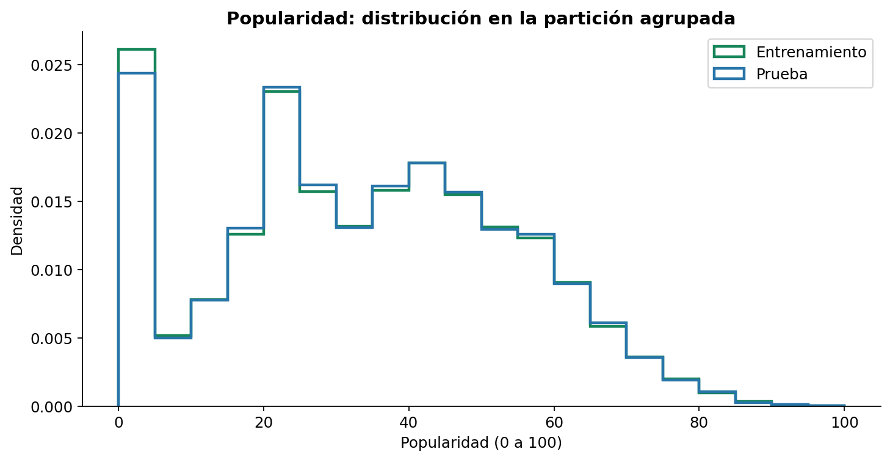
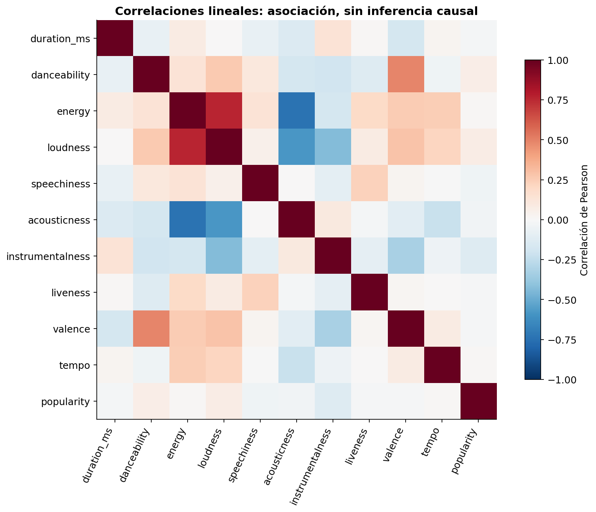
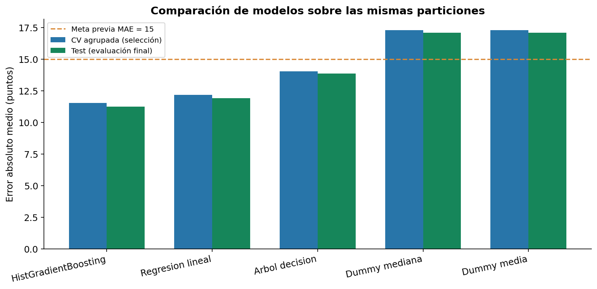
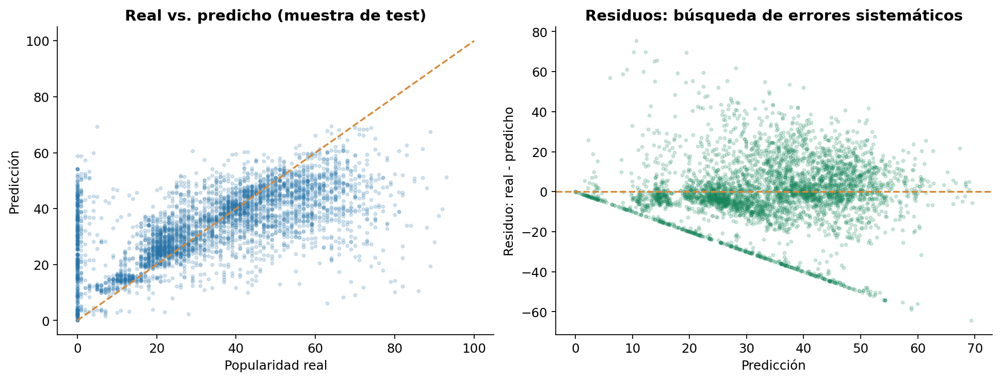
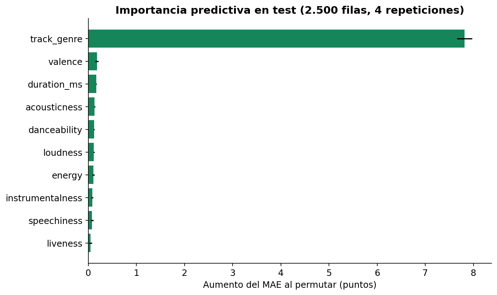
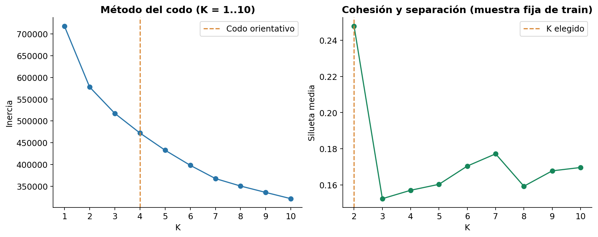
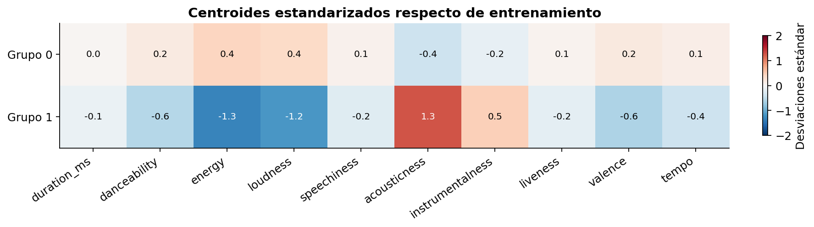
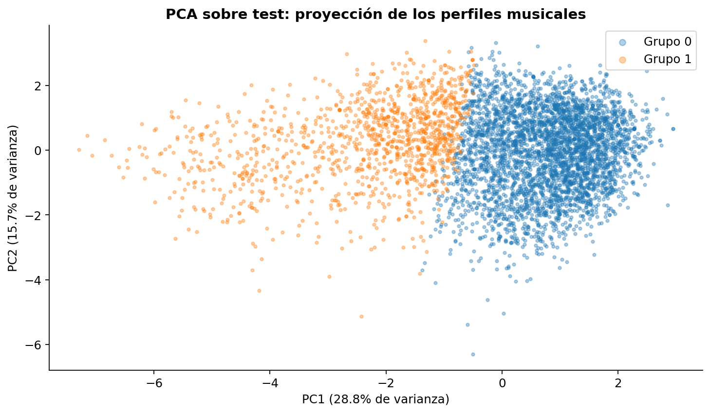
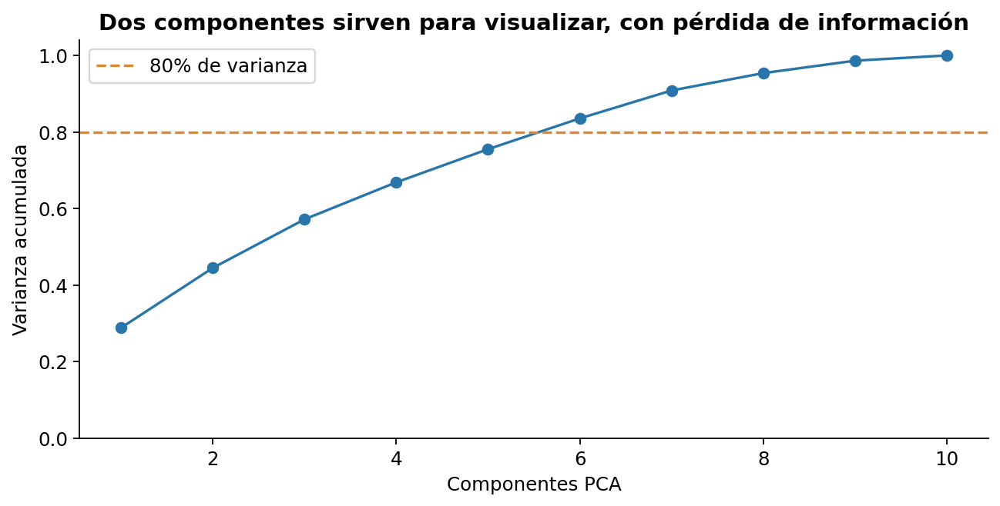
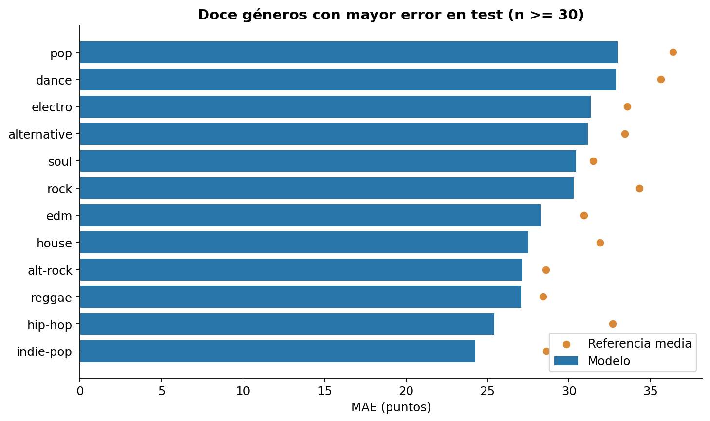

# Informe técnico - Spotify Tracks, Evaluación Parcial N°2

**MLY1101 - Machine Learning. Caso C.** Equipo: fluzxks, benjadiaz112 y Freymuth Christopher Isaac.

Este documento continúa la experiencia 1. Sus cifras se generan desde los CSV/JSON de `reports/eva2/`. Los antecedentes históricos permanecen en `docs/` y notebooks 01-04; este informe y el notebook 05 son la entrega vigente. La síntesis para decisión está en [informe ejecutivo](informe_ejecutivo.md).

## 1. Comprensión del negocio

### Problema, usuario y objetivo

Un equipo de curaduría o análisis musical necesita estudiar las características de su catálogo y contar con una estimación de popularidad observada. La pregunta predictiva es: **¿cuánta señal aportan el audio y el género para estimar `popularity` y qué perfiles musicales se pueden descubrir?** El objetivo general es desarrollar, comparar y evaluar una solución reproducible de regresión, complementada con segmentación, para apoyar una revisión humana del catálogo.

Objetivos específicos: auditar el dataset y sus versiones repetidas; preparar variables sin fuga; comparar al menos dos algoritmos supervisados; elegir K con evidencia; explicar errores y sesgos; entregar código, notebook y documentación reproducibles. El uso comercial es un escenario propuesto para el caso académico, no una necesidad de una empresa validada mediante entrevistas.

**Alcance:** estimar una puntuación de 0 a 100 en una instantánea y agrupar canciones por características acústicas. No se predicen reproducciones, ingresos, calidad musical ni popularidad futura. Sin fecha de lanzamiento o de captura no se puede construir una prueba temporal. No hay una intervención real para demostrar impacto comercial.

### KPIs previos y criterios de aceptación

| Indicador | Definición y meta previa | Resultado medido | Lectura |
|---|---|---|---|
| MAE de prueba | media de errores absolutos, <=15 puntos | 11.243 | Meta técnica cumplida |
| Mejora vs. media | 100 x (1 - MAE_modelo / MAE_media), >=10% | 34.19% | Meta técnica cumplida |
| Comparación exigente | Mejora vs. media por género de train, descriptiva sin meta previa | 5.74% | Valor incremental más acotado |
| Retención de filas brutas | Meta histórica >=95% de experiencia 1 | 78.50% | No cumple esa definición histórica |
| Retención de IDs únicos | Registros limpios / IDs originales, diagnóstico adicional | 99.73% | Distingue duplicación de descarte por calidad |
| Integridad de partición | Cero IDs y grupos de audio compartidos | 0 IDs, 0 grupos | Control contra fuga exacta |
| Reproducibilidad | Notebook integral ejecutable y pruebas de contratos | Ver acta de verificación y notebook con salidas | Evidencia técnica, no impacto de negocio |

Los documentos de experiencia 1 usan denominadores distintos: `problema_negocio.md` formula calidad sobre registros totales, mientras `informe_tecnico.md` reporta retención de IDs únicos. No son indicadores equivalentes. Esta entrega muestra ambos: 78,50% sobre filas está por debajo de 95% bajo esa definición, y 99,73% sobre IDs supera 95% bajo la otra. Las filas brutas incluyen duplicaciones por género y no equivalen a canciones distintas. No se cambia el denominador después de evaluar para simular éxito ni se atribuye la nota anterior a esta diferencia.

### KPIs de negocio y reglas del piloto propuesto

**Estado: no ejecutado.** Estas metas son propuestas de diseño para aprobación del responsable de curaduría, no resultados ni umbrales exigidos por el docente. El [plan del piloto](plan_piloto_negocio.md) define dos semanas, dos revisores y doce pares de sesiones exploratorios. Cada sesión revisaría 100 canciones y seleccionaría 20 de lotes distintos y comparables, con asignación aleatoria y orden contrabalanceado. El tamaño es propuesto, sin cálculo de potencia ni garantía de significancia.

| KPI | Definición operativa | Meta propuesta a dos semanas | Responsable propuesto |
|---|---|---|---|
| Tiempo de curaduría | Minutos por 100 = segundos / 60 / revisadas x 100; reducción por par = 100 x (1 - tiempo_asistido / tiempo_manual) | Mediana de reducciones >=15% | Coordinador de curaduría registra; datos calcula |
| Aceptación | 100 x suma(aceptadas) / suma(recomendaciones) en sesiones asistidas | >=70% | Revisores registran; coordinador revisa |
| Cobertura de géneros | 100 x géneros distintos seleccionados / mínimo(géneros disponibles, seleccionadas); delta asistida - manual | Mediana del delta >= -5 pp | Datos audita; curaduría interpreta |

Continuar el piloto exige las tres metas y revisión de calidad/derechos. Si solo mejora el tiempo, ajustar y repetir; si no hay utilidad o aparecen daños, detener. Registrar fallas y abandonos, sin ocultar sesiones desfavorables. La cobertura usa una etiqueta incompleta y no certifica diversidad cultural ni equidad.

`data/examples/pilot_template.csv` contiene solo encabezados. `src/eva2/pilot.py` valida pares y calcula métricas cuando haya observaciones reales; rechaza la plantilla vacía. Sus pruebas usan ejemplos sintéticos identificados como tales. No hay base para afirmar ahorro comercial ni ROI.

## 2. Metodología CRISP-DM y gestión del trabajo

| Fase | Aplicación concreta | Evidencia |
|---|---|---|
| Comprensión del negocio | Delimitar regresión, usuarios, KPIs y decisiones humanas | Sección 1 y plan de evaluación |
| Comprensión de datos | Identidad del archivo, esquema, nulos, duplicados, distribuciones | `data_audit.json`, `schema.csv`, EDA |
| Preparación | Limpieza histórica explícita, grupos acústicos, partición, pipelines por fold | `src/eva2/data.py`, manifiesto y pruebas |
| Modelamiento | Referencias, lineal, árbol, boosting, K-Means y PCA | CV completa, parámetros, modelos persistidos |
| Evaluación | Test reservado, residuos, bootstrap y subgrupos | Secciones 6-8, CSV de predicciones |
| Despliegue | Inferencia local ejecutable, contrato y plan de monitoreo | CLI de predicción y sección 10 |

CRISP-DM es iterativo. El hallazgo de audio repetido llevó a revisar la partición propuesta en experiencia 1 antes de entrenar. La auditoría por género se añadió para interpretar el resultado después de congelar la elección del modelo, sin usarla para reajustar parámetros. El [plan](plan_evaluacion_2.md) define las tareas y sus criterios de aceptación. Los parámetros, particiones y resultados calculados quedan persistidos para reproducir y revisar cada etapa.

## 3. Fuentes y comprensión de los datos

Fuente inmediata confirmada: CSV dentro del ZIP de la experiencia 1 entregado por el equipo, sin descargar datos alternativos. Fuente pública declarada en experiencia 1: [Spotify Tracks Dataset, MaharshiPandya](https://www.kaggle.com/datasets/maharshipandya/-spotify-tracks-dataset). La licencia anotada allí no pudo revalidarse durante esta consulta. Consultar [fuentes y trazabilidad](fuentes_eva2.md) antes de redistribuir públicamente.

- Archivo original: `data/raw/Spotify_Tracks_Dataset.csv`.
- SHA-256 recibido y calculado: `335e5ee0a07a3f30b20ca9860c87562c98082a032e0ecd90e8ca0a86d965fe58`.
- 114,000 filas, 21 columnas y 89,741 IDs diferentes.
- 3 celdas nulas, correspondientes al registro sin artista, álbum y nombre.
- 114 géneros antes de limpiar y 113 después.
- Fecha de captura, país, método de muestreo y población musical completa: no confirmados.

El README antiguo anotaba el hash b202fa49909b2d5cef71a04b1d21243cfeb36414535f2ca9272aa646721177bd. Se comprobó que es el hash del CSV al normalizar CRLF a LF, tal como hizo Git en la importación inicial. No hay evidencia de cambios en los datos por esta diferencia. Esta entrega preserva los bytes CRLF recibidos mediante `.gitattributes`, verifica su hash y rechaza un CSV distinto hasta revisar su procedencia. La cantidad observada de géneros corresponde a esta copia y no se extrapola a otras versiones.

### Diccionario de variables utilizadas

| Variable | Tipo y significado operativo | Tratamiento |
|---|---|---|
| popularity | Objetivo numérico observado de 0 a 100 | Exclusivo de y, nunca predictor |
| duration_ms | Duración en milisegundos | Continua, dominio 30.000 a 1.200.000 por criterio heredado |
| danceability, energy | Indicadores de bailabilidad y energía, 0 a 1 | Continuos |
| loudness | Indicador de sonoridad en dB | Continuo, valores negativos admisibles |
| speechiness, acousticness | Indicadores de voz hablada y carácter acústico, 0 a 1 | Continuos |
| instrumentalness, liveness | Indicadores de instrumentalidad y presencia de ambiente en vivo, 0 a 1 | Continuos |
| valence | Indicador de carácter positivo del audio, 0 a 1 | No equivale al estado emocional de una persona |
| tempo | Tempo estimado | Continuo positivo |
| track_genre | Género asignado en el archivo | Categoría nominal, una etiqueta por ID conservado |
| key, mode, time_signature | Tonalidad codificada, modo y compás | Categorías, no magnitudes ordinales |
| explicit | Bandera binaria de contenido explícito | 0/1 |
| track_id, artists, album_name, track_name | Identificación y metadatos textuales | Excluidos del modelo; ID para trazabilidad, artista solo para auditoría |
| Unnamed: 0 | Índice exportado | Eliminado |

Son características ya presentes en el CSV; no se descargó ni procesó audio. El registro de tipos, faltantes y cardinalidad está en `schema.csv`.

## 4. Preparación y EDA

### Limpieza y continuidad con experiencia 1

Se reutiliza `src/data/clean_data.py`: retirar índice, eliminar la fila sin metadatos, conservar primer `track_id`, aplicar duración 30 s-20 min y exigir tempo positivo, compás 1-5 y características normalizadas válidas. Los límites de duración son una decisión de alcance heredada, no una ley sobre música válida. Por ello pueden excluir interludios y piezas largas y sesgar la población estudiada.

| paso | filas_antes | filas_despues | filas_eliminadas |
| --- | --- | --- | --- |
| Eliminar columna de indice exportado | 114000 | 114000 | 0 |
| Eliminar registros sin artista, album o cancion | 114000 | 113999 | 1 |
| Conservar un registro por track_id | 113999 | 89740 | 24259 |
| Conservar duraciones entre 30 segundos y 20 minutos | 89740 | 89653 | 87 |
| Eliminar tempo o compas no validos | 89653 | 89495 | 158 |
| Validar caracteristicas de audio entre 0 y 1 | 89495 | 89495 | 0 |

Resultado: 89,495 canciones con IDs únicos y cero nulos. No se eliminan canciones por popularidad extrema ni por un boxplot. Un valor extremo puede ser válido. Los imputadores dentro de cada pipeline son una defensa de la transformación; en los datos auditados no sustituyeron valores. La CLI rechaza faltantes en nuevas entradas para no esconder mala calidad.

La deduplicación conserva el primer género del archivo, que está dispuesto en bloques por género. No es necesariamente el género principal del artista. Hay 16,299 IDs originales asociados a varios géneros. La regla puede sesgar su atribución. Se conserva para continuidad y se declara como limitación central. Una futura versión deberá tratar género como multietiqueta o construir una regla validada con curadores antes de evaluar otro holdout.

### Auditoría específica de la variable objetivo

Se agrupan las filas originales por `track_id` y se cuentan etiquetas distintas, primera observación, mediana, mínimo, máximo y rango. Hay **720 IDs retenidos con popularidad contradictoria**, equivalentes a 0.802% de IDs originales. El rango mediano es 1 punto y el máximo 44; 10 IDs superan 20 puntos de diferencia. Primera observación y mediana difieren en 517 canciones limpias. Detalle: `target_conflicts.csv`; resumen y criterio: `target_audit.json`.

**Política:** mantener la primera fila por continuidad con experiencia 1 y como definición reproducible de la referencia, sin afirmar que sea la popularidad verdadera en una fecha concreta. Sin fecha autoritativa no se puede justificar que la última fila, el máximo o la mediana sean la verdad. No se cambia el target del test después de haber visto resultados ni se elige una política por mejorar ese score.

Se añadió una sensibilidad limitada al entrenamiento original: mismo HGB y parámetros congelados, mismos tres folds agrupados, cambiar únicamente las etiquetas usadas para ajustar por la mediana de filas del mismo ID. Cada validación mantiene la referencia original para que la comparación mida la misma tarea. Los IDs de entrenamiento y validación permanecen separados; no se incluyen IDs de test en ajustes ni decisiones.

| fold | validation_n | changed_fit_labels | mae_first_training | mae_median_training | delta_median_minus_first |
| --- | --- | --- | --- | --- | --- |
| 1 | 23758 | 284 | 11.271 | 11.256 | -0.015 |
| 2 | 24087 | 269 | 11.787 | 11.821 | 0.033 |
| 3 | 23935 | 271 | 11.499 | 11.513 | 0.014 |

El MAE medio de CV es 11.5193 con primera observación y 11.5299 al entrenar con mediana, diferencia +0.0106 puntos; cambian 412 etiquetas de train. No demuestra que una regla sea la verdad temporal ni superior en otra población. Se mantiene la política por trazabilidad y ausencia de fuente autoritativa, no por elegir el menor número. La calidad imperfecta del objetivo sigue siendo una limitación medible.

### Hallazgos exploratorios

La media de popularidad es 33.20 y la mediana 33. Las correlaciones lineales individuales de audio con popularidad son débiles: la mayor absoluta es aproximadamente 0,128 para instrumentalidad. Esto no excluye relaciones no lineales, pero hace poco razonable atribuir el éxito a una sola propiedad acústica. EDA describe asociaciones de esta muestra, sin demostrar causalidad ni representatividad de Spotify completo.

La figura compara distribuciones normalizadas de train/test. La división preserva aproximadamente la distribución del objetivo a nivel de grupo, sin exigir que cada versión cuente como unidad independiente. `descriptive.csv`, `genres.csv` y `explicit.csv` contienen estadísticas para profundizar.

### Partición y prevención de fuga

Además de los IDs repetidos se detectan 6,213 filas con huella exacta de las 14 variables de audio/binarias, agrupadas en 83,282 huellas. 2,049 grupos contienen popularidades distintas. La misma acústica puede tener distintas puntuaciones, lo que también muestra información que el audio no permite explicar.

Se dividen **grupos completos**, estratificando por deciles de la mediana de popularidad de cada grupo, con semilla 42. La separación es 80/20 de grupos y resulta en 71,780 canciones de entrenamiento y 17,715 de prueba (19.79% de filas). Es una adaptación fundamentada del 80/20 de clase: se prioriza que versiones exactas permanezcan juntas. `split_manifest.csv` contiene ID, grupo y conjunto.

No hay IDs ni grupos exactos compartidos. Las huellas no detectan versiones casi iguales, remasterizaciones o relaciones por álbum. Los artistas sí pueden repetirse: 72.57% de las filas de test tienen la misma cadena de artistas que alguna fila de train. Por tanto, esta evaluación no es una validación estricta para artistas nuevos. La auditoría de cadenas vistas/no vistas no resuelve todas las colaboraciones.

La validación cruzada interna es GroupKFold de 3 folds sobre train. Cada estimador incorpora imputación, codificación y escalado en un `Pipeline` ajustado de nuevo dentro de cada fold. El test no participa en escalado, entrenamiento, búsqueda de parámetros ni decisión de modelo. La selección se escribe en `selection.json` antes de predecir sobre test. EDA global describe la muestra y no se utiliza para seleccionar predictores o ajustar umbrales a sus resultados.

## 5. Construcción de modelos supervisados

La tarea es **regresión**, porque se estima una puntuación numérica. Accuracy, F1 y matriz de confusión no son métricas de esta tarea. No se binariza artificialmente la popularidad para simular un problema diferente.

| Modelo | Por qué se usa | Configuración y control |
|---|---|---|
| Dummy media | Referencia de experiencia 1 y comparación de R² | Media de y de cada fold/train |
| Dummy mediana | Referencia adecuada para pérdida absoluta | Mediana de y de cada fold/train |
| Regresión lineal | Modelo trabajado en clase, interpretable y económico | Mínimos cuadrados, tol=1e-6, intercepto, sin búsqueda adicional |
| Árbol de decisión | Modelo de clase que capta reglas no lineales | max_depth [8,16,24] x min_samples_leaf [10,30], semilla 42 |
| HistGradientBoosting | Contraste adicional con ensamble de árboles | 220 iteraciones, learning_rate=0,08, max_leaf_nodes [15,31], L2 [1,10], semilla 42 |

Lineal y árbol satisfacen los dos algoritmos supervisados solicitados. El ensamble permite contrastar si una mayor flexibilidad mejora la capacidad de generalización. No se elige por ser más complejo.

Predictores: diez continuas, cuatro categóricas y `explicit`. Para lineal y árbol se aplica OneHotEncoder con categorías desconocidas ignoradas. Para el ensamble se usa OrdinalEncoder y se declaran expresamente como categóricas las columnas codificadas, evitando tratarlas como orden numérico. Categorías no vistas se codifican -1 y se marca el género desconocido en inferencia. StandardScaler de continuas facilita la regresión y una transformación coherente; no es necesario para los umbrales de los árboles.

La búsqueda evalúa 13 configuraciones en los mismos 3 folds (39 ajustes de CV, más refits). `cv_all_candidates.csv` conserva parámetros y resultados. Se selecciona el menor MAE medio de CV, incluso si una referencia constante resultara mejor. Se recortan todas las predicciones a [0,100], tanto al puntuar CV como en test e inferencia; es una regla de dominio predefinida y no un ajuste posterior para favorecer al ganador. Los estimadores minimizan error cuadrático al entrenar, mientras la selección prioriza MAE por su lectura de negocio.

Parámetros elegidos del árbol: `{'model__max_depth': 24, 'model__min_samples_leaf': 30}`. Del ensamble: `{'model__l2_regularization': 10.0, 'model__max_leaf_nodes': 31}`. Se desactiva early stopping interno en el ensamble para que no introduzca una validación por filas que mezcle grupos exactos. El número de iteraciones permanece fijo en la grilla predefinida.

La profundidad 8/16/24 explora reglas de complejidad creciente y los mínimos de 10/30 observaciones por hoja limitan hojas muy específicas. En el ensamble, 15/31 hojas contrastan capacidad, y L2=1/10 contrasta regularización. Las 220 iteraciones y tasa 0,08 son una configuración fija de alcance computacional moderado y actualización gradual, no un óptimo descubierto ni una exigencia docente. La semilla 42 facilita repetir el experimento. El ganador de la grilla alcanza el mayor número de hojas y L2 probados: la búsqueda es limitada y no permite declarar optimalidad global. Los valores se fijaron sin buscar mejoras en el test; ampliar la búsqueda requeriría un protocolo nuevo de evaluación.

## 6. Evaluación e interpretación supervisada

### Fórmulas y unidades

Para errores e_i = y_i - pred_i: MAE = media(|e_i|); MSE = media(e_i²); RMSE = raíz(MSE); R² = 1 - suma(e_i²)/suma((y_i - media(y))²). MAE y RMSE usan puntos de popularidad, MSE puntos al cuadrado. R² puede ser negativo si se predice peor que usar la media del test como referencia matemática. No es el porcentaje de canciones acertadas.

| model | cv_mae | cv_std | train_mae | mae | rmse | r2 |
| --- | --- | --- | --- | --- | --- | --- |
| HistGradientBoosting | 11.5193 | 0.2112 | 10.0023 | 11.2429 | 16.2280 | 0.3686 |
| Regresion_lineal | 12.1825 | 0.2025 | 12.0939 | 11.9083 | 16.6786 | 0.3330 |
| Arbol_decision | 14.0186 | 0.1990 | 13.7197 | 13.8474 | 17.9688 | 0.2259 |
| Dummy_mediana | 17.2885 | 0.1738 | 17.2893 | 17.0851 | 20.4274 | -0.0005 |
| Dummy_media | 17.2902 | 0.1749 | 17.2906 | 17.0850 | 20.4248 | -0.0002 |

MSE del modelo seleccionado: **263.347 puntos²**. La tabla se ordena por CV, no por test. Se reportan todos en el mismo holdout para comparación, pero la selección ya estaba congelada. CV_std expresa dispersión entre 3 folds y no es un intervalo de confianza.

En palabras de negocio, el ganador se equivoca en promedio **11.24 puntos**. Frente a predecir siempre la media, reduce el error de 17.08 a 11.24. El RMSE de 16.23, mayor que MAE, muestra influencia de errores grandes. R²=0.369 implica alrededor de 36.9% de variación explicada en esta prueba; permanece mucha variación sin explicar.

El MAE de entrenamiento del ganador es 10.00, CV 11.52 y test 11.24. Existe brecha entre entrenamiento y validación. Estos números no prueban ausencia de sobreajuste ni garantizan rendimiento futuro, pero permiten cuantificarlo. La prueba ligeramente mejor que CV puede responder a composición aleatoria del holdout.

### Incertidumbre y residuos

Con 600 remuestreos bootstrap de grupos de audio de test, el IC percentil 95% del MAE es **[10.99, 11.46]**. El IC de mejora vs. media es [33.30%, 35.25%]. Se conservan juntas las versiones exactas. Es incertidumbre condicional a este modelo y este holdout, no incorpora dependencia entre artistas ni variabilidad de reentrenar y no es un intervalo para una canción individual.

Sesgo residual medio real - predicho: -0.47. P95 del error absoluto: 37.30 puntos. Esto impide interpretar MAE como una cota de error de cada predicción. Se recortaron 10 predicciones del ganador por exceder [0,100].

| target_band | n | mae | bias | actual_mean | predicted_mean |
| --- | --- | --- | --- | --- | --- |
| 0-20 | 4842 | 15.334 | -14.980 | 8.297 | 23.277 |
| 21-40 | 5996 | 6.073 | -2.765 | 29.742 | 32.508 |
| 41-60 | 5121 | 8.938 | 7.457 | 49.585 | 42.128 |
| 61-80 | 1651 | 23.027 | 22.965 | 67.308 | 44.343 |
| 81-100 | 105 | 44.909 | 44.909 | 84.400 | 39.491 |

El modelo sobreestima canciones poco populares y subestima las muy populares. El intervalo 81-100 tiene 105 casos y MAE 44.91. No se recomienda como detector automático de futuros éxitos. El error por banda se analiza después de predecir y usa el objetivo real exclusivamente para auditoría, no como información disponible en producción.

### Dependencia del género y valor incremental

Permutar `track_genre` aumenta el MAE en 7.82 puntos en una muestra fija de 2.500 filas de test, con cuatro repeticiones. Es importancia predictiva dependiente de este modelo y muestra, no causalidad. Las variables correlacionadas pueden compartir información y la permutación romper combinaciones realistas.

Como auditoría posterior sin modificar la selección, se compara una media por género aprendida únicamente en train y una ablación HGB que **retira exclusivamente `track_genre`**. Conserva las diez continuas, `key`, `mode`, `time_signature` y `explicit`: catorce predictores. Mantiene hiperparámetros, folds y reglas de evaluación; los índices categóricos se ajustan a la nueva matriz para que tonalidad, modo y compás sigan siendo categorías. No vuelve a optimizar ni modifica la selección. `sensitivity_protocol.json` enumera las variables retenidas y la configuración común. Sustituye al contraste anterior que retiraba otras categorías y no aislaba el género.

| model | cv_mae | mae | mse | rmse | r2 |
| --- | --- | --- | --- | --- | --- |
| Media_por_genero_train | 12.218 | 11.927 | 279.114 | 16.707 | 0.331 |
| HGB_sin_genero_14_variables | 15.581 | 15.277 | 367.251 | 19.164 | 0.119 |

La mejora frente a la media por género es **5.74%**, mucho menor que 34.19% frente a la constante global. Por eso el valor incremental debe describirse con prudencia. El modelo depende de cómo el dataset asigna géneros y no demuestra que características acústicas causen popularidad. Los contrastes están en `sensitivity_genre.csv` y su protocolo confirma que no alteraron la selección.

## 7. Aprendizaje no supervisado

### Justificación, escalado y selección de K

Se propone agrupar sonidos similares para explorar perfiles de catálogo sin usar popularidad como etiqueta. K-Means es adecuado como primera técnica de clase por su sencillez y centroides interpretables; usa distancias euclidianas y favorece grupos aproximadamente compactos, por lo que no descubre necesariamente todos los estilos musicales. Se usan las diez continuas de audio, sin objetivo, género, IDs ni nombres.

StandardScaler se ajusta solo en train. Así la duración en milisegundos no domina sobre indicadores 0-1. Se mantienen variables originales sin borrar valores extremos válidos; el escalado y K-Means pueden seguir siendo sensibles a ellos. Se comparan K=1..10 con n_init=10, max_iter=300 y semilla 42 sobre todas las filas de entrenamiento.

| k | inertia | silhouette | smallest_cluster_pct |
| --- | --- | --- | --- |
| 1 | 717800.000 | N/A | 100.000 |
| 2 | 578004.842 | 0.248 | 24.721 |
| 3 | 517478.675 | 0.152 | 21.244 |
| 4 | 472287.439 | 0.157 | 7.795 |
| 5 | 432816.604 | 0.160 | 1.264 |
| 6 | 398148.934 | 0.170 | 1.236 |
| 7 | 367710.387 | 0.177 | 1.195 |
| 8 | 350507.888 | 0.159 | 1.181 |
| 9 | 335853.337 | 0.168 | 1.038 |
| 10 | 321478.368 | 0.170 | 1.037 |

La inercia siempre disminuye al aumentar K, por lo que su mínimo no selecciona un óptimo útil. El codo orientativo se calcula como la mayor distancia a la cuerda normalizada y sugiere **K=4**. No reemplaza la revisión de la curva. La regla fijada en código elige la mayor silueta de una muestra fija de 2.500 filas de train entre K=2..10, exigiendo que cada grupo cubra al menos 3% del entrenamiento. K=1 no tiene silueta definida.

Se elige **K=2**, con silueta de train 0.248 y de prueba 0.237. Silueta va de -1 a 1: una cifra cercana a 0 indica fronteras poco claras. Estos valores reflejan perfiles amplios con superposición, no una taxonomía musical definitiva. El codo y la silueta difieren: se prioriza la regla explícita de separación y parsimonia para dos macroperfiles. También se calcularon perfiles de la alternativa K=4 en train/test para sostener esa discusión con datos, sin cambiar la regla de selección:

| cluster | n | pct | energy | acousticness | speechiness | instrumentalness | tempo |
| --- | --- | --- | --- | --- | --- | --- | --- |
| 0 | 29917 | 41.679 | 0.683 | 0.272 | 0.089 | 0.044 | 119.222 |
| 1 | 21609 | 30.104 | 0.794 | 0.080 | 0.077 | 0.254 | 135.460 |
| 2 | 14659 | 20.422 | 0.263 | 0.792 | 0.051 | 0.355 | 109.401 |
| 3 | 5595 | 7.795 | 0.746 | 0.364 | 0.214 | 0.071 | 120.188 |

La alternativa aporta más detalle, pero su silueta en la misma muestra fija es 0.157, inferior a la del K elegido. Requiere interpretación de escucha antes de adoptarla. No se afirma que cuatro grupos sean incorrectos ni que la silueta decida por sí sola su valor comercial.

Estabilidad entre semillas:

| seed | ari_vs_42 |
| --- | --- |
| 7 | 0.997 |
| 2026 | 0.997 |

ARI cercano a 1 sugiere asignaciones similares bajo estas inicializaciones, aun cuando los números de cluster se permuten. No evalúa estabilidad temporal ni cambios en la muestra. Popularidad se resume después de agrupar, exclusivamente para descripción, nunca para construir o elegir grupos.

### Perfiles y aplicación de negocio

| cluster | n | pct | energy | danceability | acousticness | instrumentalness | loudness | tempo | popularity |
| --- | --- | --- | --- | --- | --- | --- | --- | --- | --- |
| 0 | 54035 | 75.279 | 0.747 | 0.595 | 0.187 | 0.122 | -6.482 | 126.202 | 33.883 |
| 1 | 17745 | 24.721 | 0.296 | 0.463 | 0.756 | 0.327 | -14.549 | 109.931 | 30.893 |

Grupo 0, **relativamente energético**: mayor energía y sonoridad, menor carácter acústico. Hipótesis de uso: ayudar al curador a explorar candidatos para listas de actividad. Grupo 1, **relativamente acústico y suave**: menor energía, mayor acústica e instrumentalidad. Hipótesis de uso: explorar selecciones tranquilas. Los nombres se asignan al interpretar promedios; no proceden de una validación de escucha ni garantizan adecuación a una actividad.

Se recomienda muestrear canciones de cada grupo y revisar diversidad de géneros y artistas antes de cualquier lista. La diferencia de popularidad media entre grupos es descriptiva y no justifica promover un perfil ni excluir el otro. No se calculó aumento de reproducciones ni retorno comercial. Los perfiles de test se guardan separados en `cluster_profiles_test.csv` para no confundir validación con entrenamiento.

### PCA y límite de la visualización

PCA se ajusta en los datos escalados de train y proyecta test. Dos componentes conservan **44.44%** de la varianza. Se requieren **6 componentes** para alcanzar 80%. El agrupamiento se ajusta en las diez dimensiones, no en este mapa reducido; un solapamiento o separación visual en dos dimensiones no demuestra por sí solo la calidad del clustering.

## 8. Ética, sesgos y seguridad

| Riesgo observado o plausible | Evidencia / límite | Control propuesto |
|---|---|---|
| Confundir popularidad con mérito | La etiqueta refleja exposición observada, no calidad | Revisión humana, no exclusión de artistas por score |
| Dependencia del género | Importancia y baseline por género; una etiqueta por ID | Mostrar límites, revisar anotación y diversidad de selección |
| Desempeño desigual | Errores desglosados por género, explicit y artistas vistos | Revisar segmentos con n suficiente, mostrar baseline del grupo |
| Sesgo de extremos | MAE alto en bandas populares | No automatizar promoción o contratos |
| Privacidad y atribución | Nombres de artistas presentes, sin datos de oyentes | No incorporar identidades al predictor, reportar agregados |
| Versiones y fuga residual | Audio exacto agrupado, versiones cercanas sin resolver | Evaluar futuras particiones por grabación y artistas |
| Procedencia y derechos | Fecha y licencia actual no confirmadas | Validar derechos antes de distribución pública |
| Persistencia de modelos | Joblib usa deserialización de objetos | Cargar solo archivos propios, verificar versiones y reentrenar |

Que no haya datos de oyentes no implica que todos los nombres de artistas carezcan de relevancia para privacidad o atribución. No se infieren atributos sensibles. El informe de errores no incluye nombres de artistas; solo IDs y la bandera de cadena de artista vista en train. Las métricas de equidad aquí son descriptivas por segmentos disponibles, no una certificación de ausencia de discriminación. No existen atributos demográficos para auditar grupos protegidos.

### Auditoría de subgrupos

| explicit | n | mae | baseline_mae | improvement_pct |
| --- | --- | --- | --- | --- |
| 0 | 16194 | 11.110 | 16.962 | 34.501 |
| 1 | 1521 | 12.658 | 18.394 | 31.185 |

| artist_seen | n | mae | baseline_mae | improvement_pct |
| --- | --- | --- | --- | --- |
| False | 4859 | 12.117 | 17.477 | 30.668 |
| True | 12856 | 10.912 | 16.937 | 35.570 |

No se interpreta una diferencia de MAE como causalidad o discriminación probada: las distribuciones de popularidad y tamaños también difieren. La referencia por grupo ayuda a contextualizarlo. `artist_seen` compara cadenas completas, no individuos tras separar colaboraciones. No es una prueba externa de artistas desconocidos.

Cinco géneros con mayor error entre los que tienen al menos 30 casos:

| track_genre | n | mae | baseline_mae | improvement_pct |
| --- | --- | --- | --- | --- |
| pop | 77 | 33.015 | 36.375 | 9.237 |
| dance | 173 | 32.887 | 35.623 | 7.679 |
| electro | 103 | 31.332 | 33.580 | 6.692 |
| alternative | 71 | 31.157 | 33.429 | 6.797 |
| soul | 59 | 30.447 | 31.472 | 3.259 |

Los grupos con menos de 30 observaciones permanecen en el CSV completo con una bandera que impide presentarlos como evidencia estable. El umbral es una regla de reporte, no prueba de significancia ni garantía estadística. No se hicieron contrastes múltiples para declarar diferencias significativas.

## 9. Arquitectura, reproducibilidad y pruebas

Flujo: CSV inmutable y hash -> limpieza -> huellas y partición -> pipelines y CV -> selección congelada -> prueba y auditoría -> K-Means/PCA -> gráficos e informes -> inferencia local. La etapa no supervisada usa la misma reserva de prueba y no depende de etiquetas del supervisado. No se requiere acceso a una API de Spotify ni credenciales.

El [README](../README.md) incluye instalación y comandos exactos. `python -m src.eva2.run` parte del CSV original y regenera todos los resultados de evaluación, gráficos, informes y modelos actuales. El notebook 05 ejecuta las mismas funciones en etapas y conserva salidas. No es un cuaderno que solo muestre resultados guardados. Los notebooks 01-04 son antecedentes históricos y no son prerrequisitos del 05.

Semilla 42, hasta cuatro hilos, tres folds de grupos y grillas explícitas. Entorno medido: Python 3.14.4; las versiones de paquetes se fijan en requirements y en `environment.json`. Cambios de hardware o bibliotecas numéricas pueden producir diferencias pequeñas. Se incluye el CSV para ejecutar sin descargar datos; no se promete soporte de versiones que no se probaron.

Pruebas automáticas: rechazo de hash distinto; huellas independientes de target/género/ID; separación reproducible de audio exacto; ajuste de escalado solo con train; validación de entradas inválidas; serialización e inferencia con género desconocido. La verificación final comprueba también ausencia de errores en notebook, coherencia de métricas y presencia de entregables. Consultar `reports/eva2/verification.json` para el resultado efectivo, sin asumirlo antes de ejecutarlo.

Las pruebas de regresión adicionales cubren: ablación que conserva todas las variables excepto género; auditoría de etiquetas sin mutar la referencia; integridad del ZIP sin invocar Git; rechazo de fuentes o CSV alterados; fórmulas del piloto y rechazo de una plantilla sin observaciones. En el repositorio se valida el CSV contra Git; en el ZIP se utiliza primero `MANIFIESTO_ENTREGA.json`, aun si la carpeta está dentro de otro repositorio. El código y entradas deben coincidir con el manifiesto, mientras las salidas pueden regenerarse. No se requiere instalar Git para ejecutar la entrega extraída. El constructor del notebook crea un kernel privado con el mismo Python que lo ejecuta, evitando seleccionar accidentalmente otro entorno global.

## 10. Despliegue local y mantenimiento

Se implementa una herramienta batch local: `python -m src.eva2.predict data/examples/tracks_example.csv --output reports/eva2/example_predictions.csv`. Acepta las 15 variables, valida dominios, carga el pipeline completo propio y entrega puntuaciones acotadas más bandera de género desconocido. El ejemplo procede de test, excluye el target y sirve para comprobar el contrato, no como nueva prueba independiente. No hay despliegue web ni producción comercial en esta entrega.

Ficha del modelo: entrada de audio/metadatos descrita arriba; salida de 0 a 100; población limitada por filtros de limpieza; uso previsto de consulta de catálogo; usos no respaldados: decisiones automáticas de financiamiento, inferencia causal y popularidad futura. El modelo persistido conserva su hash de datos, versión sklearn y parámetros.

Plan propuesto: responsable técnico del equipo revisa nulos, dominios y categorías por cada lote; responsable de curaduría revisa muestras y diversidad; cuando existan nuevas etiquetas compara MAE y errores por segmento. Revisar antes de uso si aparecen nuevas categorías frecuentes o un aumento de MAE relativo >10% frente a la referencia de validación del piloto. Ese umbral es una propuesta operativa sin validación económica. Conservar versión previa para retorno y reentrenar únicamente después de construir una nueva prueba temporal. No reusar indefinidamente este test para seleccionar mejoras.

## 11. Conclusiones

Se implementaron tres modelos supervisados y dos referencias, con selección por CV agrupada y prueba independiente. HistGradientBoosting cumple los dos objetivos técnicos iniciales, con MAE 11.24 y mejora 34.19% frente a la constante. La mejora frente al género por sí solo es 5.74%, y el error en extremos sigue siendo elevado. El resultado respalda exploración con revisión humana, no promesas de éxito musical o ROI.

K-Means aporta dos perfiles interpretables y estables ante semillas, pero la separación es limitada y no coincide con el codo de cuatro grupos. PCA muestra una parte de la estructura y no certifica estilos. La principal mejora metodológica frente a experiencia 1 es completar modelado/evaluación, controlar versiones exactas entre conjuntos y sostener las recomendaciones con errores y limitaciones medidos.

## 12. Matriz de trazabilidad de la rúbrica

| Indicador y peso | Evidencia de implementación | Justificación e interpretación |
|---|---|---|
| IE5: metodología, 20% | Secciones 1-4, 9-10; plan CRISP-DM; hash, esquema, limpieza, partición y CLI | Seis fases conectadas con objetivos y KPIs; partición revisada por audio repetido |
| IE6: supervisados, 30% | Secciones 5-6; lineal, árbol y ensamble; grillas, CV y selección persistida | Regresión para objetivo numérico, selección por MAE y control de fuga entre grupos |
| IE7: no supervisados, 30% | Sección 7; escalado, K=1..10, codo/silueta, perfiles, estabilidad y PCA | K=2 maximiza silueta elegible; K=4 es alternativa explorada; perfiles y varianza limitada explícitos |
| IE8: interpretación, 20% | Secciones 6, 8 y 11; métricas, residuos, contraste por género y límites | Mejora medible para consulta de catálogo; errores altos en extremos limitan decisiones de promoción |

La matriz se respalda con el protocolo de ablación controlada, la auditoría de etiquetas y sensibilidad sin modificar el test, los KPIs comerciales propuestos en el [plan de piloto](plan_piloto_negocio.md) y las comprobaciones reproducibles de `reports/eva2/verification.json`.

Entregables formales: informe Markdown, síntesis ejecutiva, notebook ejecutado, dataset, modelos, figuras, fuentes y carpeta organizada. Esta matriz identifica evidencias; no asigna una nota ni sustituye el juicio del docente o la defensa individual.

## 13. Referencias

[Material del profesor y fuentes primarias verificadas](fuentes_eva2.md). La pauta entregada define los requisitos, y las guías 2.1-2.4 orientan el método. Se adaptan los ejemplos bancarios al caso Spotify. Documentación adicional del ensamble: [HistGradientBoostingRegressor, scikit-learn 1.8](https://scikit-learn.org/1.8/modules/generated/sklearn.ensemble.HistGradientBoostingRegressor.html). [Regresión lineal](https://scikit-learn.org/1.8/modules/generated/sklearn.linear_model.LinearRegression.html) y [árbol de regresión](https://scikit-learn.org/1.8/modules/generated/sklearn.tree.DecisionTreeRegressor.html). Consulta: 20 de octubre de 2026.
